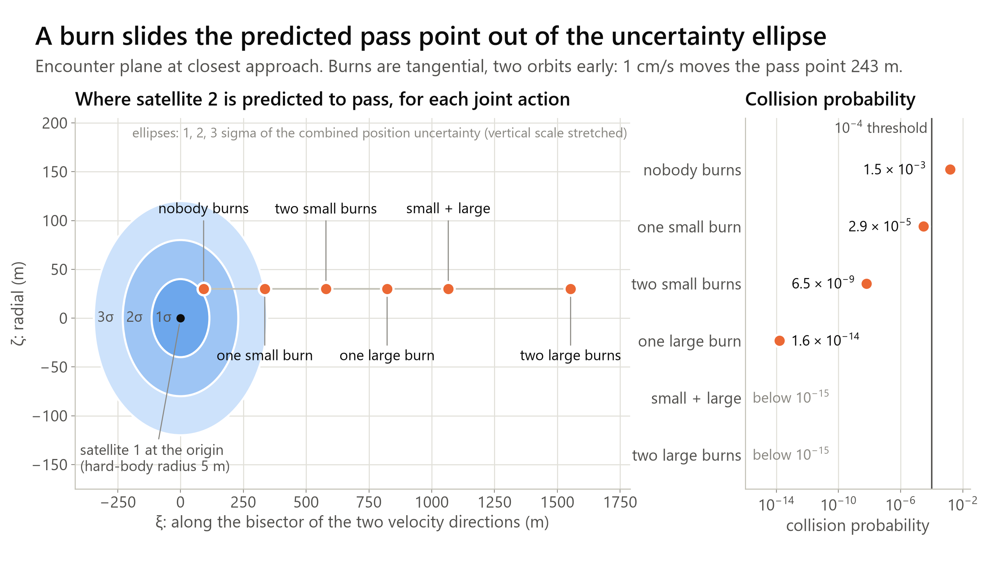
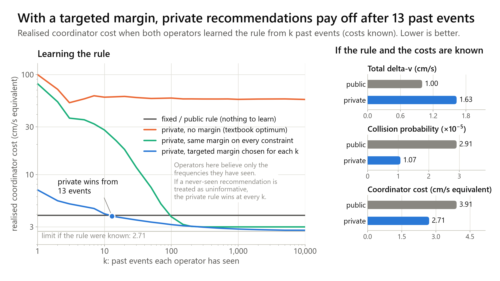
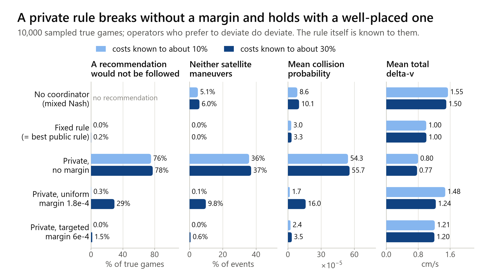
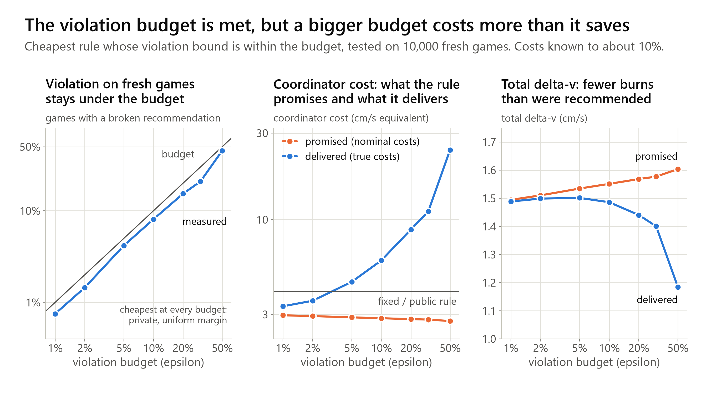
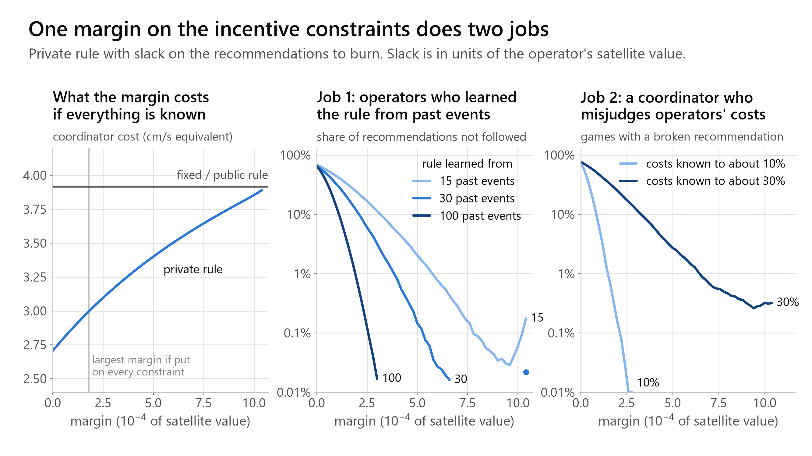
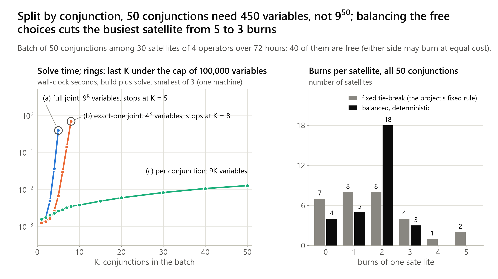
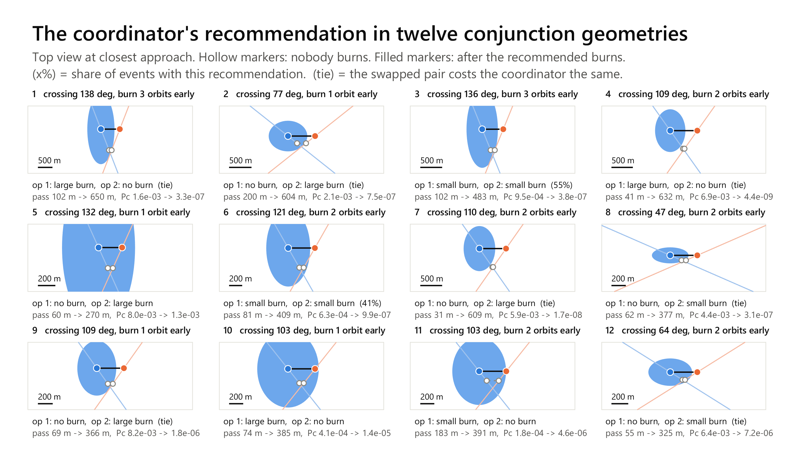

# RESULTS.md

**Can operators learn to trust a coordinator? Maneuver recommendations for a two-operator satellite conjunction.**

This project is about civil space traffic coordination. Everything below comes from `run_all.py` with fixed random seeds; the numbers are in `results/results.json`, except section 4.10, which comes from `run_scaleup.py` and `results/scaleup.json`, and section 4.11, which comes from the MATLAB layer in `matlab/` and `matlab/results/`. A statement is made here only if a test or a run in this repository shows it. Formulas are derived in DERIVATIONS.md.

## 1. The question and the short answer

Two maneuverable satellites from different operators have a predicted close approach. Each operator would burn if the other did not, and would rather not if the other did. A neutral coordinator recommends who burns and how much. It has no authority, so a recommendation works only if following it is in each operator's own interest.

Game theory offers the coordinator a tool that beats any fixed rule on paper: private, randomised recommendations (a correlated equilibrium). The question of this project is what that tool is worth when two idealisations are dropped:

1. operators do not know the rule the recommendations are drawn from and have to learn it from the past events they have seen;
2. the coordinator does not know the operators' costs exactly.

Short answer, for the baseline conjunction (all statements are about this model):

- **On paper**, with the rule and the costs known, the best private rule costs the coordinator 0.0271 against 0.0391 for the fixed rule, which is also the best public rule: 31% lower. It uses more delta-v (1.63 against 1.00 cm/s) to buy a lower collision probability (1.07e-5 against 2.91e-5). Without a coordinator (mixed Nash equilibrium) the cost is 0.0989 and nobody maneuvers in 4.9% of events.
- **That textbook rule cannot be learned from past events.** It leaves an operator exactly indifferent, so any estimation error breaks it. Its realised cost stays between 0.56 and 0.61 for every k from 5 to 10,000 past events, about 15 times the public rule.
- **A margin on the obedience constraints repairs this, and where the margin goes matters.** The same margin on every constraint (the chance-constrained form) cannot exceed about 1.886e-4 (1.8e-4 is the last point of the grid used). The cap comes from the constraint "told small burn, deviation large burn", whose sign does not depend on what the operator believes, so it needs no protection against estimation error. A targeted margin, only on the two constraints where an operator is unsure what the other was told ("told small burn, deviation no burn"), can reach 1.04e-3 on its grid.
- **How many past events?** Costs known, operators starting from one observation of each recommendation (convention A, used in every experiment): with the targeted margin chosen for each k, the private rule beats the public rule by at least 1% from **13 past events** (exact enumeration over every integer k; on the simulation grid the first point is 15). With the same margin on every constraint it takes 96 (grid: 100). The gain over the public rule with the targeted margin is about 6% at 20 past events, 10% at 30, 14% at 50, 19% at 100, 24% at 300 and 27% at 1,000; the limit is 31%.
- **The 13 depends on how operators treat thin evidence.** If a recommendation an operator has never seen leaves it with a uniform belief (convention B), the best targeted rule is below the public rule at every k from 1, because an operator who knows nothing burns by default. From 20 past events on, the best targeted costs under the two conventions agree within 0.41%. So "how many events" measures how far operators trust thin evidence; it is not a constant of the problem.
- **The one-parameter targeted family loses little** against a grid of two-parameter rules: 3.8% at k = 10, at most 0.54% from k = 15 (exact, convention A).
- **Misjudged costs, rule known.** Costs known to about 10% (covariance scale to about 5%): the margin rules are broken in at most 0.31% of sampled games and cost 0.0319 to 0.0359 against 0.0402 for the public rule. Costs known to about 30% (covariance scale to about 10%): broken in 29% (same margin 1.8e-4), 13% (targeted 3e-4) or 1.5% (targeted 6e-4) of games, and every private rule costs more than the public rule. The rule without a margin is broken in three quarters of games at both levels.
- **Choosing the margin from samples** (73 candidate rules, exact binomial bounds, union bound) meets the violation budget on fresh games in every row. Chosen by realised cost, the private rule costs 0.0315 against 0.0401 for the public rule with costs known to 10%, and 0.0434 against 0.0433 (equal within noise) with costs known to 30%.
- **Both imperfections together** (convention A, covariance-scale uncertainty 0.1 at both levels). Costs known to 10%: the private rule gains 3.5% at 15 past events, 11% at 30, 18% at 100, 20% at 300 and 22% if the rule is known. Costs known to 30%: never better than the public rule.
- So the simple rules used in practice are the right tool for operators who meet rarely or whose costs are poorly known, and private recommendations are worth it for operators who meet often and are well understood. The margin that makes a private rule work is the quantity the chance-constrained correlated equilibrium adds, but placed only where learning can go wrong.

The first bullet depends on the baseline being a case where coordination matters. Over 300 random conjunctions drawn from a pre-declared family, private recommendations beat public ones in 28% of instances (section 4.6).

Many conjunctions at once (section 4.10; rule known, zero margin). A synthetic 72-hour batch of 50 conjunctions among 30 satellites of 4 operators splits into one small program per conjunction, because each operator's cost adds up over its conjunctions. If exactly one satellite burns in every conjunction (the exact-one restriction), every obedient rule is a lottery over designations that could be announced publicly; this needs a no-tie condition that holds in every draw of the run. Over 200 batches, the best public rules are on average 5.3% cheaper than the cheapest such designations, and the private optima 24.4% cheaper. The model ignores that a burn changes the same satellite's later conjunctions.

## 2. How the baseline was chosen

The baseline was fixed from the principles below before any scheme was compared with any other. Nothing in it was changed afterwards.

1. **Geometry.** Both satellites near-circular at 550 km, velocity directions 90 degrees apart at closest approach. Burns are tangential, 1 cm/s (small) or 3 cm/s (large), two whole orbits before closest approach, so that the "3 dv dt" drift formula has no periodic correction.
2. **Encounter.** Combined 1-sigma uncertainty 115 m by 40 m, combined hard-body radius 5 m, nominal miss 92 m by 30 m. Chosen so that the collision probability is about 1.5e-3 if nobody burns (clearly actionable), about 3e-5 after one small burn (under the usual 1e-4 threshold, by a factor of three), and negligible after two small burns or one large one.
3. **Costs.** Satellite values $200M and $80M; propellant priced as satellite value per 100 m/s of lifetime budget; a fixed disruption cost of $60k and $16k per maneuver. A small burn then costs 4.0e-4 and 3.0e-4 of the satellite's value. Each operator would burn alone, and would not add a burn after the other's. That is the game of chicken the project is about (DERIVATIONS.md 3.4).
4. **Coordinator.** It minimises total delta-v plus 1000 m/s times collision probability: it would spend 1 cm/s to remove 1e-5 of collision probability, where the operators need 3e-4 to 4e-4. The gap stands for the cost a collision imposes on everyone else.
5. **Uncertainty.** Each operator's propellant price, disruption cost and satellite value are lognormal around the nominal value with log-standard-deviation 0.3 ("known to about 30%"); the covariance sigma-scale is lognormal with 0.1.

Several things were added after seeing first results. They are method or reporting choices, not changes to the baseline, and each is disclosed where it is used:

- a second reading of who knows the true covariance (section 4.9), added to see how much of the covariance sensitivity comes from that assumption;
- a second, better-informed uncertainty level (10% on costs, 5% on the covariance scale), added when the 30% level turned out to break the first private rules; the full grid of levels is in section 4.3 so the two points hide nothing;
- the targeted margin family, which replaced an earlier second family when a two-parameter check showed that the earlier families were capped too low (section 7). It has one parameter. Wherever a margin is chosen, it is chosen on one sample and evaluated on an independent one; the margins 3e-4 and 6e-4 are two illustrative members, not tuned values;
- a selection of the margin by realised cost, added when selection by a violation budget turned out to pick poor rules (section 4.4);
- after an independent review: an exact (sampling-free) evaluation of the learning model, the second starting convention B (used only in that exact check), a second public benchmark in the instance family (section 4.6), and a diagnostic for the infeasible scenario program (section 4.8).

## 3. The baseline game

Collision probability for each joint action (2D Foster integral):

| | Op. 2: no burn | Op. 2: small | Op. 2: large |
|---|---|---|---|
| **Op. 1: no burn** | 1.488e-3 | 2.913e-5 | 1.6e-14 |
| **Op. 1: small** | 2.913e-5 | 6.5e-9 | below 1e-15 |
| **Op. 1: large** | 1.6e-14 | below 1e-15 | below 1e-15 |

Coordinator's cost of each joint action, in m/s (delta-v + 1000 x collision probability): both small 0.0200; one large 0.0300; one small 0.0391; nobody 1.488.

Equilibria of the nominal game:

- two pure Nash equilibria: exactly one operator does a small burn;
- one mixed Nash equilibrium: operator 1 waits with probability 18.9%, operator 2 with 25.9%, and **neither burns in 4.9% of events**;
- the large burn is strictly dominated for both operators. It stays in the action set and matters only when the true covariance is larger than nominal.

The fixed rule "the operator with the cheaper maneuver does the smallest burn that brings the nominal collision probability under 1e-4" designates operator 2 with a small burn. That happens to be one of the two pure equilibria and also the coordinator's best public rule, so in the baseline "fixed rule" and "best public rule" are the same thing. A category rule of the Satcat kind does not separate two maneuverable satellites and falls back on bilateral coordination; designating operator 1 instead gives the other pure equilibrium, with the same collision probability and the same coordinator cost.



## 4. Results

"Coordinator cost" is always total delta-v plus 1000 m/s times collision probability, in m/s (the figures show it in cm/s). Margins are in units of the operator's satellite value, like the costs (DERIVATIONS.md 3.2). A private rule has 12 obedience constraints: (operator, recommended action, deviation). Two margin families are used:

- **same margin on every constraint** (scheme `private_uniform`, family `uniform`; the chance-constrained form): feasible up to about 1.886e-4 (DERIVATIONS.md 4.7); on the 1e-5 grid used it has 19 members, the last at 1.8e-4;
- **targeted margin** (schemes `private_targeted_3`, `private_targeted_6`, family `targeted`): the margin only on the constraints selected by `games.uncertain_belief_rows`, which in the baseline are "told small burn, deviation no burn" for each operator. On a 2e-5 grid it has 53 members, the last at 1.04e-3. The family stops where every recommendation would reveal what the other operator was told, because such a rule is public in effect.

### 4.1 If the rule and the costs are known

| Rule | What is recommended | Delta-v (cm/s) | Collision prob. | Neither burns | Coordinator cost |
|---|---|---|---|---|---|
| No coordinator (mixed Nash) | nothing; each mixes on its own | 1.55 | 8.3e-5 | 4.9% | 0.0989 |
| Fixed rule | operator 2 does a small burn | 1.00 | 2.9e-5 | 0 | 0.0391 |
| Best public rule | the same as the fixed rule | 1.00 | 2.9e-5 | 0 | 0.0391 |
| Private, no margin | both small 63%; only op. 1 22%; only op. 2 15% | 1.63 | 1.07e-5 | 0 | 0.0271 |
| Private, same margin 1.8e-4 | both small 48%; only op. 1 30%; only op. 2 22% | 1.48 | 1.52e-5 | 0 | 0.0300 |
| Private, targeted margin 3e-4 | both small 39%; only op. 1 35%; only op. 2 26% | 1.39 | 1.77e-5 | 0 | 0.0316 |
| Private, targeted margin 6e-4 | both small 21%; only op. 1 45%; only op. 2 33% | 1.21 | 2.29e-5 | 0 | 0.0350 |

Compared with the public rule the private rules are 31%, 23%, 19% and 10% cheaper (in table order). Every private rule satisfies all 12 obedience constraints on the nominal costs; in the run the largest constraint value of every private table is 0, and the tests check every family member to solver tolerance. The private no-margin table matches the closed-form solution in DERIVATIONS.md 4.4 (tested to 1e-6).

### 4.2 If operators have to learn the rule

Operators do not know the table. Each has seen k past events, forms its belief from them, and best-responds (DERIVATIONS.md 5.1). Costs are known. Two conventions for what an operator believes before it has seen much:

- **A, "one observation each"** (code `start="observed"`, used in every experiment and figure): k - 1 past events plus, for every recommendation the operator can receive, one observation drawn from the true conditional. Beliefs are always observed frequencies.
- **B, "uniform when unseen"** (code `start="uniform"`, used only in the exact check of 4.2 (b)): exactly k past events; a recommendation that never occurred leaves a uniform belief about the other operator's action.

**(a) Simulation, convention A.** Realised coordinator cost (40,000 simulated histories per entry for the fixed rules; the last column picks the targeted margin on 20,000 histories and evaluates it on 100,000 independent ones; standard error in brackets):

| k past events | Fixed / public | Private, no margin | Same margin 1.8e-4 | Targeted 3e-4 | Targeted 6e-4 | Best targeted margin for this k |
|---|---|---|---|---|---|---|
| 5 | 0.0391 | 0.572 | 0.3534 | 0.2622 | 0.1226 | 0.0478 (0.0001), margin 10.4e-4 |
| 10 | 0.0391 | 0.595 | 0.2795 | 0.1700 | 0.0591 | 0.0405 (0.0001), margin 8.8e-4 |
| 15 | 0.0391 | 0.601 | 0.2182 | 0.1140 | 0.0428 | **0.0378** (0.0001), margin 8.0e-4 |
| 20 | 0.0391 | 0.605 | 0.1786 | 0.0849 | 0.0374 | 0.0367 (0.0001), margin 7.0e-4 |
| 30 | 0.0391 | 0.590 | 0.1180 | 0.0523 | 0.0353 | 0.0351 (0.0001), margin 5.4e-4 |
| 50 | 0.0391 | 0.577 | 0.0742 | 0.0368 | 0.0350 | 0.0335 (0.0001), margin 4.0e-4 |
| 100 | 0.0391 | 0.583 | 0.0379 | 0.0317 | 0.0350 | 0.0316 (0.0001), margin 2.6e-4 |
| 300 | 0.0391 | 0.570 | 0.0300 | 0.0316 | 0.0350 | 0.0298 (0.00002), margin 1.6e-4 |
| 1,000 | 0.0391 | 0.566 | 0.0300 | 0.0316 | 0.0350 | 0.0285 (0.00002), margin 8.0e-5 |
| 10,000 | 0.0391 | 0.564 | 0.0300 | 0.0316 | 0.0350 | 0.0278 (below 0.00001), margin 4.0e-5 |

- **The no-margin rule does not improve with k.** From k = 5 on, both operators follow the recommendation in 29% to 36% of events and nobody burns in 36% to 40%. This is the binding-constraint effect of DERIVATIONS.md 5.2.
- **With a margin, obedience goes to one.** With the targeted margin 3e-4 both follow in 96.9% of events at k = 30, 99.2% at 50 and 99.98% at 100; with 6e-4, in 99.2% at k = 15.
- **Crossover on the grid.** The best targeted rule is below the public rule from k = 15 (0.0378 against 0.0391, a 3.4% gain, more than 3 standard errors) and at every larger k; at k = 10 it is 0.0405, still worse. With the same margin on every constraint the first such grid point is k = 100. The criterion is a gain of at least 1% that is more than 3 standard errors and holds at every later grid point.
- **The best margin shrinks as k grows:** the largest targeted margin (1.04e-3) up to k = 7, then 8.0e-4 at 15, 4.0e-4 at 50, 1.6e-4 at 300, 4.0e-5 at 10,000. With many events a small margin is enough, and a small margin costs little.
- Before the crossover a failed private recommendation is expensive because it can end with nobody burning, which leaves the 1.5e-3 collision probability in place.
- The Hoeffding bound of DERIVATIONS.md 5.3 is above the simulated failure rate in every stored case (for example 0.14 against a simulated 0.015 at k = 100 with the same margin 1.8e-4).

**(b) Exact enumeration, both conventions.** `exact_checks.run` enumerates every possible history of past events, so these numbers carry no sampling noise. Best realised cost over each family's members (chosen margin in brackets):

| k | Targeted, A | Targeted, B | Same margin, A | Same margin, B |
|---|---|---|---|---|
| 1 | 0.0708 (10.4e-4) | 0.0331 (10.0e-4) | 0.8165 | 0.3644 |
| 2 | 0.0546 (10.4e-4) | 0.0349 (9.4e-4) | 0.5347 | 0.1953 |
| 3 | 0.0509 (10.4e-4) | 0.0361 (8.4e-4) | 0.3666 | 0.1122 |
| 5 | 0.0478 (10.4e-4) | 0.0377 (10.2e-4) | 0.3528 | 0.2054 |
| 10 | 0.0403 (9.0e-4) | 0.0381 (9.2e-4) | 0.2792 | 0.2489 |
| 13 | 0.0384 (8.6e-4) | 0.0378 (8.6e-4) | 0.2419 | 0.2327 |
| 15 | 0.0379 (8.2e-4) | 0.0376 (8.2e-4) | 0.2190 | 0.2147 |
| 20 | 0.0367 (7.0e-4) | 0.0369 (7.0e-4) | 0.1787 | 0.1807 |
| 30 | 0.0352 (5.4e-4) | 0.0353 (5.6e-4) | 0.1192 | 0.1201 |
| 100 | 0.0316 (2.8e-4) | 0.0316 (2.8e-4) | 0.0377 | 0.0378 |
| **First k with a gain of at least 1% over the public rule (0.0391), held at every later k** | **13** | **1** | **96** | **97** |

The exact grid is every k from 1 to 40, then 50, 70, 100, 150, 200 and 300, and for the same-margin family also every k from 41 to 130. "Beats" means a realised cost at most 0.99 times the public rule's (0.03874).

In plain words: under convention A the private rule pays off from 13 past events; under convention B it pays off from the first. The difference is what an operator does with a recommendation it has hardly seen. Under B, an operator that has never seen a recommendation has a uniform belief about the other, and with that belief burning is its best response (DERIVATIONS.md 5.4), which the coordinator likes. Under A, an operator told to burn has at least one observation of what the other was told with that recommendation; if that one or two observations happened to show the other also burning, it waits, and when the other was told to wait nobody maneuvers. That is why the best targeted cost under B rises from 0.0331 at k = 1 to 0.0382 at k = 8 and 9 and then falls, while under A it falls from 0.0708. From k = 20 on, the best targeted costs under the two conventions agree within 0.41% (the same-margin costs within 2.1%). The same-margin rule needs 96 or 97 past events under either convention. So the 13 is a property of how operators treat thin evidence, not a constant of the problem.

**(c) How much does the one-parameter family leave on the table?** In the baseline every private rule uses three joint actions (both small, only operator 1, only operator 2), so a rule is fixed by two numbers: for each operator, the probability that the other was told no burn given that it was told to burn (DERIVATIONS.md 4.4). A 25 x 25 grid of such rules, evaluated exactly under convention A:

| k | Best two-parameter rule | Best targeted rule (margin) | Gap of the targeted rule |
|---|---|---|---|
| 10 | 0.0388 | 0.0403 (9.0e-4) | +3.81% |
| 15 | 0.0377 | 0.0379 (8.2e-4) | +0.54% |
| 20 | 0.0366 | 0.0367 (7.0e-4) | +0.32% |
| 30 | 0.0351 | 0.0352 (5.4e-4) | +0.12% |
| 50 | 0.0335 | 0.0334 (4.0e-4) | -0.10% |
| 100 | 0.0317 | 0.0316 (2.8e-4) | -0.16% |

At k = 50 and 100 the targeted family is slightly ahead because the grid is coarser than the family there. The simulated version of the same check (`two_parameter_check`, the same 25 x 25 grid, k up to 1,000, picked on one set of simulated histories and evaluated on another) gives gaps between -0.6% and +0.4% from k = 15 on. The family is therefore close to the best three-action rule from 15 past events, but not at k = 10.

**(d) The share of recommendations not followed rises again at the largest targeted margins** (`margin_tradeoff.png`, middle panel, 15 past events: 0.03% at 9.6e-4, 0.17% at 1.04e-3). Near the end of the family the rule becomes lopsided: operator 2 is told to burn in 35% of events at 9.6e-4 but in only 14% at 1.04e-3, so after 15 events it has seen that recommendation only a few times and learns slowly what it implies.



### 4.3 If the coordinator misjudges the operators' costs

Here operators know the rule. The coordinator computed it from nominal costs; the true game is one of 10,000 samples. Operators know their own true costs and the true covariance scale, and an operator who prefers to deviate does so, assuming the other follows. "Violation" is the share of true games in which at least one recommendation that can be issued would not be followed. The two levels use different samples of 10,000 games.

Costs known to about 10%, covariance scale to about 5% (standard error of the cost in brackets):

| Rule | Violation | Realised cost | Neither burns | Mean collision prob. | Above 1e-4 | Delta-v (cm/s) |
|---|---|---|---|---|---|---|
| No coordinator (mixed Nash of each true game) | n/a | 0.1011 | 5.1% | 8.6e-5 | 5.1% | 1.55 |
| Fixed rule = best public rule | 0.00% | 0.0402 (0.0001) | 0 | 3.0e-5 | 0.00% | 1.00 |
| Private, no margin | 75.55% | 0.551 (0.006) | 35.8% | 5.4e-4 | 35.8% | 0.80 |
| Private, same margin 1.8e-4 | 0.31% | 0.0319 (0.0002) | 0.09% | 1.7e-5 | 0.09% | 1.48 |
| Private, targeted 3e-4 | 0.00% | 0.0323 (0.0001) | 0 | 1.8e-5 | 0.00% | 1.39 |
| Private, targeted 6e-4 | 0.00% | 0.0359 (0.0001) | 0 | 2.4e-5 | 0.00% | 1.21 |

Costs known to about 30%, covariance scale to about 10% (the baseline level):

| Rule | Violation | Realised cost | Neither burns | Mean collision prob. | Above 1e-4 | Delta-v (cm/s) |
|---|---|---|---|---|---|---|
| No coordinator (mixed Nash of each true game) | n/a | 0.1158 | 6.0% | 1.0e-4 | 6.4% | 1.50 |
| Fixed rule = best public rule | 0.20% | 0.0432 (0.0002) | 0 | 3.3e-5 | 0.82% | 1.00 |
| Private, no margin | 77.65% | 0.565 (0.006) | 37.0% | 5.6e-4 | 37.4% | 0.77 |
| Private, same margin 1.8e-4 | 29.5% | 0.173 (0.003) | 9.8% | 1.6e-4 | 10.3% | 1.24 |
| Private, targeted 3e-4 | 12.85% | 0.097 (0.002) | 4.4% | 8.4e-5 | 5.0% | 1.30 |
| Private, targeted 6e-4 | 1.54% | 0.0473 (0.0008) | 0.65% | 3.5e-5 | 1.32% | 1.20 |

The "no coordinator" rows use 2,000 of the sampled games; in all of them (10% level) and in 99.9% of them (30% level) the true game still has three equilibria, two pure and one mixed.

- With costs known to 10%, all three margin rules keep their advantage: 0.0319 and 0.0323 against 0.0402 for the public rule (21% and 20% lower), and 0.0359 (11% lower) for the larger targeted margin.
- With costs known to 30%, no private rule beats the public rule. The targeted 6e-4 rule is rarely broken (1.54%) but still costs 9% more (0.0473 against 0.0432). The fixed rule is the most robust object in the comparison (0.20% violation).
- The no-margin rule is broken in three quarters of true games at both levels, for the same reason as in 4.2: it sits on the indifference boundary.
- The nominal mixed Nash equilibrium, used as a prediction, fails in 100% of true games at both levels, because a mixed equilibrium needs exact indifference.

Violation rate over a grid of uncertainty levels (log-standard-deviations; 10,000 games per cell, a third set of samples). Each cell: same margin 1.8e-4 / targeted 6e-4.

| Cost uncertainty \ covariance-scale uncertainty | 0 | 0.05 | 0.1 | 0.2 | 0.3 |
|---|---|---|---|---|---|
| 0 | 0.0% / 0.0% | 0.0% / 0.0% | 0.0% / 0.0% | 3.0% / 0.3% | 11.1% / 2.9% |
| 0.05 | 0.0% / 0.0% | 0.0% / 0.0% | 0.0% / 0.0% | 3.4% / 0.2% | 11.9% / 3.1% |
| 0.1 | 0.2% / 0.0% | 0.4% / 0.0% | 0.8% / 0.0% | 5.3% / 0.3% | 14.0% / 3.2% |
| 0.2 | 10.7% / 0.0% | 11.2% / 0.0% | 12.4% / 0.1% | 17.4% / 0.9% | 25.1% / 5.3% |
| 0.3 | 26.7% / 1.2% | 27.8% / 1.1% | 28.4% / 1.4% | 32.2% / 4.4% | 38.5% / 10.7% |

Where a grid cell has the same setting as a table above, the numbers differ slightly because the samples differ (for example 28.4% here against 29.5% above for the same-margin rule at 0.3 / 0.1).

For comparison the public rule stays at or below 0.27% in the first three columns, and reaches 0.33% to 2.6% (covariance 0.2) and 3.2% to 7.5% (covariance 0.3). The same-margin rule needs cost knowledge of about 10% or better; the targeted 6e-4 rule tolerates 20% (0.05% at covariance 0.1). In the same grid cells its realised cost is below the public rule's at 20% cost uncertainty and covariance 0.1 (0.0387 against 0.0434) and above it at 30% (0.0460 against 0.0427). When operators know the true covariance scale, as assumed here, the same-margin rule also needs covariance-scale knowledge of about 10% or better; the targeted 6e-4 rule is broken in 0.2% to 0.9% of games at covariance 0.2 and in 2.9% to 5.3% at covariance 0.3, with costs known to 20% or better. The covariance sensitivity comes from the steep dependence of the residual collision probability on the covariance (DERIVATIONS.md 1.6). Section 4.9 shows it disappears if operators act on the coordinator's published collision probabilities.



In the figure, "uniform margin 1.8e-4" is the same margin on every constraint.

### 4.4 Choosing the margin from samples

The chance-constrained reading: pick the cheapest rule (nominal coordinator cost) whose violation probability is at most eps. This is done over a list of 73 candidates (the 19 + 53 members of both margin families, with the shared zero-margin rule counted once, and the two pure-equilibrium public rules) with 10,000 calibration games and an exact binomial upper bound, corrected for looking at 73 candidates (union bound, overall confidence 99.9%; DERIVATIONS.md 6.2). The chosen rule is then tested on 10,000 fresh games. Standard error of the realised cost in brackets.

Costs known to about 10% (covariance scale 5%):

| eps | Chosen rule | Bound from calibration | **Violation on fresh games** | Realised cost on fresh games |
|---|---|---|---|---|
| 1% | private, same margin 1.6e-4 | 0.98% | **0.75%** | 0.0333 (0.0004) |
| 2% | private, same margin 1.4e-4 | 1.75% | **1.45%** | 0.0357 (0.0005) |
| 5% | private, same margin 1.1e-4 | 4.78% | **4.17%** | 0.0454 (0.0008) |
| 10% | private, same margin 0.9e-4 | 9.16% | **8.08%** | 0.0596 (0.0011) |
| 20% | private, same margin 0.7e-4 | 17.27% | **15.36%** | 0.0882 (0.0016) |
| 30% | private, same margin 0.6e-4 | 23.33% | **20.86%** | 0.1111 (0.0020) |
| 50% | private, same margin 0.3e-4 | 47.52% | **45.25%** | 0.2425 (0.0036) |
| chosen by realised cost | private, targeted 2.2e-4 | 0.24% | **0.08%** | 0.0315 (0.0001) |
| public rule | operator 2 does a small burn | 0.11% | **0.00%** | 0.0401 (0.0001) |

Costs known to about 30% (covariance scale 10%):

| eps | Chosen rule | Bound from calibration | **Violation on fresh games** | Realised cost on fresh games |
|---|---|---|---|---|
| 1% | private, targeted 7.2e-4 | 0.94% | **0.79%** | 0.0443 (0.0006) |
| 2% | private, targeted 6.0e-4 | 1.89% | **1.64%** | 0.0478 (0.0008) |
| 5% | private, targeted 4.6e-4 | 4.76% | **4.08%** | 0.0579 (0.0011) |
| 10% | private, targeted 3.6e-4 | 9.29% | **8.31%** | 0.0770 (0.0015) |
| 20% | private, targeted 2.6e-4 | 18.04% | **16.04%** | 0.1104 (0.0020) |
| 30% | private, targeted 2.0e-4 | 26.44% | **24.23%** | 0.1477 (0.0024) |
| 50% | private, same margin 1.0e-4 | 49.30% | **46.83%** | 0.2714 (0.0037) |
| chosen by realised cost | private, targeted 9.0e-4 | 0.54% | **0.42%** | 0.0434 (0.0004) |
| public rule | operator 2 does a small burn | 0.46% | **0.25%** | 0.0433 (0.0002) |

Three findings:

1. **The out-of-sample violation rate is below eps in every row at both levels.** This is the out-of-sample check of the chance constraint, and it passes.
2. **A larger eps buys a lower nominal cost and a much higher realised cost**, at both levels. With 10% cost knowledge the realised cost is already worse than the public rule's from eps = 5% (0.0454 against 0.0401); with 30% it is worse at every eps, even 1% (0.0443 against 0.0433). A broken recommendation is expensive because it can end with nobody burning. For their vertiport game, Im, Topcu and Fridovich-Keil (arXiv:2603.14141) also report a realised cost that is not monotone in the confidence level.
3. **Choosing by realised cost works where costs are well known.** The margin was also chosen by realised cost on the calibration games, and the violation it implies is reported. With 10% cost knowledge that selects the targeted margin 2.2e-4: 0.08% violation and realised cost 0.0315 on fresh games against 0.0401 for the public rule (21.6% lower). With 30% cost knowledge it selects the targeted margin 9.0e-4: 0.0434 (0.0004) against 0.0433 (0.0002), equal within noise, not better.



### 4.5 Both imperfections together

Operators learned the rule from k past events (convention A) *and* the true costs differ from nominal. 50,000 sampled games per level; the covariance-scale uncertainty is 0.1 at **both** levels, so the 10% row here is a different setting from the 10% level of 4.3 (covariance 0.05). The targeted margin is picked for each k on 20,000 other games and histories. Realised coordinator cost (chosen targeted margin in brackets):

| Cost knowledge | Rule | k = 15 | k = 30 | k = 100 | k = 300 | k = 1,000 | rule known |
|---|---|---|---|---|---|---|---|
| 10% | Fixed / public | 0.0435 | 0.0435 | 0.0435 | 0.0435 | 0.0435 | 0.0435 |
| 10% | Private, best targeted margin | 0.0420 (8.0e-4) | 0.0388 (5.8e-4) | 0.0358 (3.2e-4) | 0.0347 (2.6e-4) | 0.0342 (2.6e-4) | 0.0339 (2.4e-4) |
| 10% | Private, same margin 1.8e-4 | 0.2295 | 0.1451 | 0.0594 | 0.0402 | 0.0366 | 0.0357 |
| 30% | Fixed / public | 0.0434 | 0.0434 | 0.0434 | 0.0434 | 0.0434 | 0.0434 |
| 30% | Private, best targeted margin | 0.0452 (9.8e-4) | 0.0439 (9.2e-4) | 0.0436 (8.6e-4) | 0.0435 (8.8e-4) | 0.0435 (8.6e-4) | 0.0436 (8.4e-4) |
| 30% | Private, same margin 1.8e-4 | 0.3078 | 0.2486 | 0.1944 | 0.1787 | 0.1711 | 0.1688 |

Standard errors are 0.0001 for the public rule and 0.0001 to 0.0002 for the targeted rule.

- With 10% cost knowledge the targeted rule beats the public rule at every k run: by 3.5% at 15 past events, 10.8% at 30, 17.8% at 100, 20.2% at 300 and 22.1% if the rule is known. The same-margin rule is better only from somewhere between 100 and 300 past events (7.7% at 300).
- With 30% cost knowledge no private rule is better at any k. The targeted rule is 4.2% worse at 15 past events, 1.1% worse at 30 (about 2 standard errors) and within one standard error of the public rule from 100 on.

The figure below shows the targeted margin doing both jobs: what it costs if everything is known, how it lowers the share of recommendations that are not followed after 15, 30 or 100 past events, and how it lowers the share of true games with a broken recommendation when costs are known to 10% or 30% (rule known, 10,000 games each). The vertical line marks 1.8e-4, the last grid point of the same margin on every constraint (its analytic limit is about 1.886e-4).



### 4.6 Private versus public recommendations

Private: each operator sees only its own instruction (a correlated equilibrium). Public: both see the whole joint recommendation, so the coordinator can only randomise over Nash equilibria (DERIVATIONS.md 4.5). Both were solved on the same instances.

**Baseline, everything known.**

| | Public | Private | Change |
|---|---|---|---|
| Total delta-v | 1.00 cm/s | 1.63 cm/s | +0.63 cm/s |
| Collision probability | 2.91e-5 | 1.07e-5 | -1.84e-5 (63% lower) |
| Coordinator cost | 0.0391 | 0.0271 | 31% lower |

Keeping recommendations private does not save delta-v here. It buys a lower collision probability for more delta-v, at an exchange rate the coordinator likes (0.63 cm/s for 1.84e-5; the coordinator would pay 1.84 cm/s for that). The mechanism: privately, the coordinator can get both operators to burn 63% of the time, which no public announcement can, since "both burn" is not an equilibrium.

**With a margin.** The public rule holds with a margin of up to 1.7e-4 at unchanged cost, 0.0391 (`games.solve_public(c1, c2, obj, margin=mu)` on a 1e-5 grid of mu). The private rule costs 0.0300 with the same margin 1.8e-4 (23% lower than public), 0.0316 with the targeted margin 3e-4 (19% lower) and 0.0350 with 6e-4 (10% lower).

**With the margin chosen from samples, on the same sampled games.** In section 4.4 the private rule chosen by realised cost and the public rule were evaluated on the same 10,000 fresh games. Costs known to about 10% (covariance scale 5%): the private rule (targeted 2.2e-4) uses 1.45 cm/s and leaves a mean collision probability of 1.70e-5; the public rule uses 1.00 cm/s and leaves 3.01e-5. That is +0.45 cm/s for 1.31e-5 less collision probability (44% lower), and a coordinator cost of 0.0315 against 0.0401. Costs known to about 30% (covariance scale 10%): the private rule (targeted 9.0e-4) uses 1.07 cm/s and leaves 3.27e-5, the public rule 1.005 cm/s and 3.32e-5: +0.07 cm/s for 0.05e-5 less (2% lower), and a coordinator cost of 0.0434 against 0.0433, equal within noise (`calibration_sigma_0.1` and `calibration`, keys `realised_cost_choice` and `public_choice`).

**In practice the gap depends on what the operators know (sections 4.2 to 4.5).** The value of private recommendations is 31% with full knowledge; about 20% when costs are known to 10% and the rule is known (21.6% for the rule chosen by realised cost in 4.4); from 3.5% at 15 past events to 21% at 1,000 with 10% cost knowledge (4.5); with costs known under convention A, below 1% up to 12 past events and negative up to 11; and zero at best with 30% cost knowledge. A public rule needs no learning at all, because nothing about the other operator has to be inferred.

**Across random instances.** 300 conjunctions were drawn from a family declared before looking at any of them (crossing angle 40 to 140 degrees; burn lead time 1, 2 or 3 orbits; sigmas 80 to 160 m and 25 to 60 m; hard-body radius 3 to 10 m; nominal miss up to 1.5 sigma on each axis; satellite values $30M to $300M; propellant budgets 50 to 200 m/s; disruption costs $5k to $100k; same burn sizes and coordinator weight). Two public benchmarks: the best mixture over all Nash equilibria, mixed ones included (the hull), and the best mixture over pure equilibria only, which is the public rule used in the baseline experiments. They differ in 29 instances, where the best public rule over the hull is not a single pure equilibrium.

| | Against the hull of all equilibria | Against pure equilibria only |
|---|---|---|
| Instances where private beats public at all | **28.0%** (38% of the 72.7% anti-coordination instances) | **28.0%** (38%) |
| Relative saving when positive: 10th, 25th, 50th, 75th, 90th percentile | 6%, 14%, 26%, 37%, 43% | 9%, 22%, 37%, 54%, 64% |
| Mean relative saving over all 300 | 7.2% | 10.3% |
| When positive: change in delta-v and in collision probability | +0.46 cm/s, -2.5e-5 | +0.84 cm/s, -4.5e-5 |

"Anti-coordination" means two pure equilibria in each of which exactly one operator burns; the instances have one, two or three pure equilibria in 56, 219 and 25 cases. The baseline's 31% is above the median against the hull and below the median against pure equilibria only, and the instances with any gain are a minority. In the other 72% the best public rule is already the coordinator's optimum.

### 4.7 A safety chance constraint

Constraint: the probability, over the coordinator's draw and the uncertain covariance scale, that the recommended joint action leaves the collision probability above 1e-4 is at most 5% (DERIVATIONS.md 6.3; 200,000 covariance-scale draws per level). One small burn alone leaves the collision probability above 1e-4 with probability 0.9%, 11.9% and 21.7% for covariance-scale uncertainty 0.1, 0.2 and 0.3.

| Covariance-scale uncertainty | Public rule | Private rule (no margin) |
|---|---|---|
| 0.1 | satisfied (0.9%) | satisfied (0.3%) |
| 0.2 | **cannot be satisfied** (11.9%) | satisfied without change (4.4%) |
| 0.3 | cannot be satisfied (21.7%) | **cannot be satisfied** (8.0% unconstrained) |

A private rule can meet a safety constraint that no public rule can, because it can make both operators burn most of the time (63% in the unconstrained rule). At 0.3 neither can: the program with the incentive constraints and the safety constraint is infeasible, so both operators would have to burn more often than the incentive constraints allow. Incentive compatibility limits how safe a recommendation-only coordinator can make things; beyond that it would need payments or authority.

### 4.8 The plain scenario program

The scenario approach in its plain form imposes the incentive constraints in every one of N sampled games, with N from the theory for eps = 5% and confidence parameter 1e-6 (DERIVATIONS.md 6.1).

| Uncertainty | N = 608 (Campi-Garatti) | N = 1899 (Calafiore-Campi) |
|---|---|---|
| Costs 30%, covariance 10% | infeasible | infeasible |
| Costs 5%, covariance 2% | feasible; violation on 10,000 fresh games **0.84%** | feasible; **0.04%** |

Where the program is feasible, the out-of-sample violation is far below 5%, as the theory says it should be.

**Why it is infeasible at the baseline uncertainty.** A deletion filter (`experiments.infeasible_subset`) finds, for each N, a set of constraints that is infeasible on its own while every proper subset is feasible (both properties re-checked in the run). In both cases it is **six constraints from three sampled games**, with the same structure. For N = 608:

- In two games the covariance scale is large (1.20 and 1.315 times nominal), so a lone small burn leaves the collision probability near 1e-4 (8.1e-5 at scale 1.2 and 1.1e-4 at 1.3; `baseline/pc_vs_k`). There, an operator told to do a small burn while the other waits prefers a large burn. A lone small burn can then be recommended only if "both small" is recommended often enough alongside it.
- In each of the same two games one operator's large burn costs more than it removes whatever the other does (operator 1 at scale 1.315, operator 2 at scale 1.20), so neither operator can be told to do a large burn; and at scale 1.20 operator 2, told to wait while operator 1 also waits, prefers a large burn. That removes "large burn" and "nobody burns" from the table.
- In the third game operator 1's small burn costs 3.4 times nominal (1.34e-3 of its satellite's value against 4.0e-4). It follows "small burn" only if "both small" is recommended at most 0.034 times as often as "only operator 1 burns", while the game at scale 1.20 requires at least 0.061 times as often (first point). Both hold only if operator 1 is never told to burn. Operator 2, told to burn, is then always alone, and at scale 1.315 it would rather do the large burn, so it cannot be told to burn either. Nothing is left.

For N = 1899 the same pattern appears with operator roles partly swapped; there the expensive game has operator 2's small burn at 2.8 times nominal. So the program fails because a handful of extreme sampled games ask for opposite things, not because of the number of games as such. This is why section 4.4 uses a finite list of candidates with exact binomial bounds.

### 4.9 Who knows the covariance? A second reading

Everywhere above, operators know the true covariance scale and the coordinator does not. The other natural reading is that operators act on the coordinator's published collision probabilities, so only their cost weights are private; the true covariance then changes what actually happens but not what operators choose. Both readings were run on the same 10,000 sampled games for each level (a separate sample from 4.3).

| Cost / covariance uncertainty | Rule | Violation, operators know the true scale | Violation, operators use published values | Realised cost, true scale | Realised cost, published |
|---|---|---|---|---|---|
| 0.1 / 0.05 | Fixed / public | 0.00% | 0.00% | 0.0401 | 0.0401 |
| | Private, same margin 1.8e-4 | 0.32% | 0.26% | 0.0318 | 0.0316 |
| | Private, targeted 3e-4 | 0.00% | 0.00% | 0.0322 | 0.0322 |
| 0.1 / 0.2 | Fixed / public | 0.62% | 0.00% | 0.0521 | 0.0532 |
| | Private, same margin 1.8e-4 | 5.55% | 0.17% | 0.0579 | 0.0381 |
| | Private, targeted 3e-4 | 1.55% | 0.00% | 0.0454 | 0.0403 |
| | Private, targeted 6e-4 | 0.21% | 0.00% | 0.0468 | 0.0461 |
| 0.1 / 0.3 | Fixed / public | 4.16% | 0.00% | 0.0607 | 0.0654 |
| | Private, same margin 1.8e-4 | 14.39% | 0.21% | 0.1004 | 0.0452 |
| | Private, targeted 3e-4 | 8.14% | 0.00% | 0.0757 | 0.0482 |
| | Private, targeted 6e-4 | 3.34% | 0.00% | 0.0652 | 0.0560 |
| 0.3 / 0.1 | Fixed / public | 0.17% | 0.00% | 0.0430 | 0.0431 |
| | Private, same margin 1.8e-4 | 28.29% | 27.23% | 0.1684 | 0.1619 |
| | Private, targeted 3e-4 | 12.49% | 11.35% | 0.0950 | 0.0906 |
| | Private, targeted 6e-4 | 1.43% | 1.22% | 0.0464 | 0.0459 |
| 0 / 0.3 | Fixed / public | 3.47% | 0.00% | 0.0594 | 0.0641 |
| | Private, same margin 1.8e-4 | 11.14% | 0.00% | 0.0867 | 0.0436 |
| | Private, targeted 6e-4 | 3.03% | 0.00% | 0.0630 | 0.0549 |

- If operators act on published collision probabilities, covariance error alone breaks no recommendation (the 0 / 0.3 rows; also tested), and the private rules stay ahead of the public rule even at a covariance-scale uncertainty of 0.3 (0.045 to 0.056 against 0.065), as long as costs are known to about 10%.
- With 30% cost uncertainty every private rule costs more than the public rule in either reading.
- The public rule does slightly *worse* under the published reading at high covariance uncertainty (0.0654 against 0.0607). Operators who know the true risk is higher sometimes do a larger burn than they were told, which counts as a broken recommendation and lowers the collision probability.

So the covariance sensitivity reported in section 4.3 belongs to the first reading. Which reading is right depends on whether operators trust their own covariance assessment over the coordinator's, and that is an empirical question about operators.

### 4.10 Many conjunctions at once

Everything in this section comes from `run_scaleup.py` with fixed seeds; the numbers are in `results/scaleup.json` (key paths in brackets). Every parameter was fixed before the first run; the spread over further batches, the breakdown of rejected draws, the per-conjunction comparison with public rules and the count of burn-size ties were added after it, without changing any parameter or earlier value. The batch game and the proofs are in DERIVATIONS.md 7. The rule is known and the margin is zero throughout: nothing about learning or misjudged costs was run on the batch.

**The batch.** 30 satellites of 4 operators with fleets of 12, 8, 6 and 4 satellites; a 72-hour window. A conjunction is a pair of satellites of two different operators, drawn uniformly without replacement from the 320 such pairs, with a fair coin for which satellite is side 1 and a time of closest approach uniform on the window (used only to order the conjunctions). Its game is one draw of the instance family of section 4.6, redrawn until it has at least one *stable designation*: a cell in which exactly one satellite burns (SN, LN, NS or NL, side 1 first) and which is a pure Nash equilibrium of that conjunction's game. Each operator's cost is the sum of its satellites' costs over their conjunctions, the coordinator's cost is the sum over conjunctions, and each operator is told the recommendations for all its satellites at once. The *master batch* has 50 conjunctions (seed 72); the batch of size K is its first K conjunctions, so curves against K compare like with like. 200 further batches of 50 (seeds 1000 to 1199) give the spread.

Over the 201 batches, 10,050 of 10,557 draws were kept (95.2%; `family`). In the 507 rejected draws nobody burning is a pure equilibrium (415) or a pure equilibrium has both sides burning (92); 415 + 92 = 507, and no rejected draw lacks a pure equilibrium (`family/rejected_breakdown`). Of the kept conjunctions, 17.7% have one stable designation and 82.3% have two, always one for each side; 95.3% of the latter are *free*: both designations cost the coordinator the same (relative difference at most 1e-9). Kept draws are not a random sample of the family: with 95.2% kept, a batch of 50 unfiltered draws would consist only of conjunctions with a stable designation with probability 0.952^50, about 8.5% (arithmetic, treating draws as independent). In the master batch 50 of 53 draws were kept (`family_master_only`).

**Three formulations, one solver.** All are linear programs solved with HiGHS through `scipy.optimize.linprog`: (a) the full joint program over all 9^K joint actions; (b) the exact-one joint program over the 4^K joint actions in which exactly one satellite burns in every conjunction, with the same obedience rows (the restriction is taken from Im, Topcu and Fridovich-Keil, arXiv:2609.13565, known here through notes; NOVELTY.md); (c) one stacked program with a 3 x 3 table and its 12 obedience rows per conjunction, 9K variables. For the exact-one case there is also a closed form (c'): the sum over conjunctions of the cheapest stable designation, with no program at all. A joint program is built only up to 100,000 variables. Wall-clock seconds are build plus solve, the smallest of 3 repeats, on the laptop used here; they describe that machine, not the method (`timing`):

| K | (a) full joint: variables | seconds | (b) exact-one joint: variables | seconds | (c) per conjunction: variables | seconds |
|---|---|---|---|---|---|---|
| 1 | 9 | 0.0014 | 4 | 0.0012 | 9 | 0.0015 |
| 3 | 729 | 0.0048 | 64 | 0.0016 | 27 | 0.0020 |
| 5 | 59,049 | 0.39 | 1,024 | 0.0067 | 45 | 0.0026 |
| 6 | over the cap | | 4,096 | 0.029 | 54 | 0.0028 |
| 8 | over the cap | | 65,536 | 0.69 | 72 | 0.0035 |
| 10 | over the cap | | over the cap | | 90 | 0.0037 |
| 20 | over the cap | | over the cap | | 180 | 0.0059 |
| 50 | over the cap | | over the cap | | 450 | 0.012 |

The closed form (c') takes at most 1.5e-5 s at every K of the grid. What stops (a) and (b) is the cap on variables, not time: at their last sizes they take under a second, and the next sizes would be 9^6 = 531,441 and 4^9 = 262,144 variables (arithmetic). Two separate things are at work, and both matter. The exact-one restriction alone still leaves 4^K joint actions, so on its own it does not make K = 50 tractable. What does is that costs add up over conjunctions, so the batch program splits into K programs of one conjunction each (P2 below); that is why (c) has 9K variables and (c') none.

**What was checked.** The run checks the following at every K of the grid within the size cap, and stops without writing a results file if a relative difference exceeds 1e-6 or a constraint is violated by more than 1e-9; `tests/test_batch.py` checks the same at small sizes (`propositions`; proofs in DERIVATIONS.md 7.2 to 7.5).

- P1, single-slot deviations are enough: adding the rows for an operator that deviates in several of its conjunctions at once leaves the optimum unchanged and the optimum violates none of them (K = 1 to 5, with content from K = 2, where an operator first has two slots; largest relative difference 1.5e-16, largest violation 4.2e-17).
- P2, decomposition: optimum of (a) = optimum of (c) = sum of the single-conjunction private optima of `games.solve_private` (largest relative difference 2.0e-16, at K = 1 to 5 for (a), at every K of the grid for (c)); the per-conjunction marginals of the (a) optimum obey each conjunction's 12 rows, and the product of the (c) tables obeys the joint rows (largest violations 2.8e-17 and 3.0e-17).
- P3, exact-one restriction: optimum of (b) = closed form (c') at K = 1 to 8 (largest relative difference 0), the (b) optimum puts no mass outside products of stable designations (0), and (b) is infeasible on a 3-conjunction batch in which one conjunction has the first rejected draw of seed 72 as its game.
- P5, burden-sharing needs only marginals: see below.

**What the exact-one restriction means in this model.** If every recommended joint action has exactly one satellite burning, an operator told to burn knows that the other side was told to wait. Unless, for some side, both the small and the large burn are best replies to the other side waiting (the exact condition is in DERIVATIONS.md 7.4), in an obedient rule an operator told to wait also knows what the other side was told. So no recommendation leaves an operator uncertain about the other side, and every obedient rule restricted in this way is a mixture of stable designations; conversely every mixture of stable designations is obedient (P3, checked as above and in `test_p3_every_mixture_of_stable_products_is_obedient`). The run contains no such tie: none of the 20,100 slots (2 x 10,050 sides) of the kept conjunctions has one (`family/n_slots_with_burn_size_tie` = 0), and no kept conjunction has two stable designations on the same side (`family/n_two_on_the_same_side` = 0). With a tie the conclusion can fail; DERIVATIONS.md 7.4 gives a hand-built example, checked by a test. Two consequences are arguments, not batch experiments. First, a private recommendation carries nothing here that a public announcement of the designation would not, so the designation can be announced publicly (proved in DERIVATIONS.md 7.4, consequence 3, under the same no-tie condition). Second, a publicly announced pure equilibrium needs no learning, for the same reason as the public rule of section 4.6: nothing about the other operator has to be inferred. The coordinator's cost is lowest at the cheapest stable designation of each conjunction, so mixing helps only to share the burden.

**What it costs.** Three totals per batch: the sum of the private optima (rule known, zero margin), the sum of the best public rules (the cheapest pure equilibrium of each conjunction, which may have both sides burning), and the sum of the cheapest stable designations. Batch totals are carried by a few expensive conjunctions, so a single batch is a poor basis for a gap. Over the 200 further batches (`totals_further_batches/summary`; gaps relative to the larger total):

| Gap over 200 batches of 50 | Mean | Median | 5th to 95th percentile | Min to max |
|---|---|---|---|---|
| private optima below the cheapest stable designations | 24.4% | 23.2% | 11.4% to 39.8% | 5.2% to 46.9% |
| best public rules below the cheapest stable designations | 5.3% | 0.66% | 0% to 19.9% | 0% to 28.2% |
| private optima below the best public rules | 20.2% | 19.7% | 8.4% to 32.6% | 4.7% to 45.0% |

The public-versus-stable gap is zero in 28 of the 200 batches (counted over `totals_further_batches/batches`), at most 0.66% in half of them (the median) and large in a few. The restriction rules out cells in which both sides burn, and in the master batch every public rule that beats the cheapest stable designation uses such a cell (below).

*Worked example: the master batch, which is high.* Its gap between private optima and stable designations, 41.5% at K = 50, is above the 95th percentile of the 200 further batches (7 of the 200 are higher; counted over `totals_further_batches/batches`). At K = 50 the three totals are 2.205, 3.180 and 3.768 (`totals/K50`), so the private optima are 41.5% below the stable designations, the public rules 15.6% below, and the private optima 30.6% below the public rules; at K = 20 the three gaps are 40.9%, 1.25% and 40.2% (`totals/K20`). The public rules beat the cheapest stable designation in 4 of the 50 conjunctions, with "both small" (SS) in three and "side 1 small, side 2 large" (SL) in one. That one, conjunction 45 (index counted from 0), has a single stable designation (side 1 large burn) costing 0.854, against 0.284 for its best public rule; it alone carries 0.570 of the 0.588 difference between the public and stable totals (0.854 - 0.284 = 0.570, 3.768 - 3.180 = 0.588), so the 15.6% is almost entirely one conjunction (`master_batch`, `totals/K50/public_strictly_cheaper_than_stable`).

*Share of conjunctions against share of cost.* Over the 10,000 conjunctions of the further batches, the private optimum is strictly cheaper than the best public rule in 29.4% of conjunctions, and the mean relative saving per conjunction is 9.66% (median 29.2% where positive; `family_private_vs_public`). Yet the batch totals differ by 20.2% on average. The two numbers do not contradict each other: the gains sit in the expensive conjunctions, and a total weighs conjunctions by their cost. In the master batch at K = 50 the 15 conjunctions with a gain carry 58.8% of the public total (`totals/K50`). The 29.4% is close to the 28% of section 4.6, but the samples differ: section 4.6 has 300 instances of the unfiltered family, while here the 4.8% of draws without a stable designation are left out (and a gain counts above a relative saving of 1e-6 there, 1e-9 here). None of these gaps is what a coordinator would gain in practice. They are computed with the rule known and zero margin; section 4.2 shows how much of such a gain survives when operators have to learn the rule.

**Who burns, and burden-sharing.** Every conjunction first gets a cheapest stable designation; this fixes the coordinator cost. Only the free conjunctions are left to decide, so the three variants below have the same coordinator cost. In the master batch 15 of the first 20 conjunctions and 40 of the 50 have a stable designation on each side, and all of those are free (`propositions/P4`).

- *Fixed tie-break*: in each free conjunction, the side that the project's fixed rule designates burns (`model.fixed_rule_profile` with `cheaper=True`: the side whose smallest sufficient burn is cheaper in USD).
- *Balanced, randomised*: the probability that side 1 burns in each free conjunction, chosen to minimise the largest expected number of burns of any satellite. This needs only one variable per free conjunction plus one (P5): at K = 6, 8 and 10 of the master batch it gives the same value as the program over all joint assignments of the free conjunctions (1.0 in each case, with 6, 7 and 9 variables against 33, 65 and 257; `propositions/P5`).
- *Balanced, deterministic*: a 0/1 choice per free conjunction minimising the largest number of burns (`scipy.optimize.milp`). It agrees with brute force over all assignments in the 10 master-batch prefixes of the K grid with at most 12 free conjunctions (K = 1 to 15; `burden/brute_force_agreement`). None of the 200 further batches has so few free conjunctions. There, and in the master batch at K = 20 and 50, the value equals the randomised value rounded up (`test_deterministic_balance_is_the_randomised_value_rounded_up`), which is the smallest value any 0/1 choice can have; DERIVATIONS.md 7.5 (Proposition 6) proves that the two are always equal in this model. The optimal value is unique; the assignment found is one of possibly several.

Largest number of burns of any satellite (`burden`):

| | Free conjunctions | Fixed tie-break | Balanced, randomised (expected) | Balanced, deterministic |
|---|---|---|---|---|
| Master batch, K = 20 | 15 | 2 | 1.0 | 1 |
| Master batch, K = 50 | 40 | 5 | 2.2 | 3 |
| 200 further batches of 50: mean (min to max) | 39.2 (30 to 48) | 4.6 (3 to 7) | 2.20 (1.76 to 4.0) | 2.38 (2 to 4) |

In the master batch at K = 50 the fixed tie-break leaves 7, 8, 8, 4, 1 and 2 satellites with 0 to 5 burns; the deterministic solution found leaves 4, 5, 18 and 3 satellites with 0 to 3 burns (`burden/master_K50`). Both histograms account for the 50 burns. A burn counts as one whatever its size.

**Carry-over, the main limitation.** A burn moves a satellite, so it changes that satellite's later conjunctions; the model treats every conjunction as fixed. In the master batch at K = 50, ordered by time of closest approach, 39 conjunctions (fixed tie-break) or 40 (balanced deterministic) involve a satellite already designated to burn in an earlier conjunction, and all 50 share a satellite with at least one other conjunction (`carry_over`). So carry-over would touch most of the batch; how much it would change the costs was not computed. The batch result is about the structure of the game and the size of the programs; it is not a usable maneuver schedule.



Left: wall-clock seconds (log scale, one laptop) against the number of conjunctions K for the three formulations, labelled with their number of variables; rings mark the last K under the cap of 100,000 variables. Right: number of satellites by number of burns in the master batch at K = 50, fixed tie-break against the balanced deterministic solution found; the coordinator cost is the same for both.

**What this shows and what it does not.** In this model, where costs add up over conjunctions, a batch of 50 conjunctions is 50 small programs, and that is checked against the joint programs as far as they can be built (K = 5 and K = 8). Under the exact-one restriction the coordinator can only choose among stable designations, which could be announced publicly; over 200 synthetic batches that costs on average 5.3% against the best public rules and leaves the private optima, with the rule known, 24.4% below. Among designations of equal cost, balancing lowers the largest number of burns of one satellite at no cost to the coordinator. It does not show anything about learning on the batch, about real conjunction statistics (pairs are drawn uniformly and every game is a synthetic draw, so the same satellite has an independently drawn value, propellant budget and disruption cost in each of its conjunctions), about margins or misjudged costs, or about what happens after a burn changes the later conjunctions.

### 4.11 Two-body check of the burn-to-miss rule (MATLAB layer)

Every result above uses the linear rule (2.5) of DERIVATIONS.md for how far a burn moves the pass point. This section replaces it by a two-body propagation of both satellites and asks whether anything in the game changes. It comes from the MATLAB layer in `matlab/` (`run_twobody_check.m`; numbers in `matlab/results/twobody_check.json`). MATLAB reads the model parameters and the Python reference numbers from `matlab/params.json` and `matlab/expected.json`, both written by `export_matlab.py`, so no parameter is typed a second time.

**Method.** Both satellites start from their states at the nominal closest approach, are propagated back two orbits on their two-body orbits, receive their burns along their own velocity (posigrade for satellite 1, retrograde for satellite 2, the convention of DERIVATIONS.md 2.5) and are propagated forward again with `ode113` (relative tolerance 1e-13, absolute tolerance 1e-9). The closest approach is then found by iteration on the two orbits, and the miss vector is expressed in the encounter plane at that instant. A second propagator, the analytic universal-variable solution of Kepler's problem, repeats the calculation.

**(a) The linear rule is off by at most 19 mm.**

| Op. 1, op. 2 | Pass distance, linear rule (m) | Propagated minus linear (mm) | Collision probability, linear rule | Relative change with the propagated miss |
|---|---|---|---|---|
| no burn, no burn | 92.000 | 0.006 | 1.4881e-3 | -2.8e-10 |
| no burn, small | 335.485 | 5.202 | 2.9134e-5 | -1.3e-4 |
| no burn, large | 822.455 | 8.865 | 1.6223e-14 | -5.5e-4 |
| small, no burn | 335.485 | 1.128 | 2.9134e-5 | -2.9e-5 |
| small, small | 578.970 | 6.325 | 6.4600e-9 | -2.8e-4 |
| small, large | 1065.939 | 9.987 | 4.6142e-22 | -8.0e-4 |
| large, no burn | 822.455 | 10.124 | 1.6223e-14 | -6.3e-4 |
| large, small | 1065.939 | 15.319 | 4.6142e-22 | -1.2e-3 |
| large, large | 1552.909 | 18.979 | 5.4221e-43 | -2.2e-3 |

"Pass distance" is the component of the miss vector along the bisector of the two velocity directions, the only component a burn moves (DERIVATIONS.md 2.4).

- The error is largest when both do the large burn: 18.98 mm on a shift of 1,461 m. As a fraction of the shift it is at most 2.1e-5 (one small burn by operator 2).
- The radial component of the miss vector moves by at most 2.5e-6 m.
- The errors are understood. A second-order formula, derived step by step in DERIVATIONS.md 2.7, reproduces all nine within 1.2e-5 m. It adds a term in the square of the burn (1.1 mm for 1 cm/s, 10.1 mm for 3 cm/s, with opposite signs for the two operators) and a term proportional to operator 2's burn (6.3 mm per cm/s). The second comes from the way the encounter is set up: satellite 2 passes 30 m above satellite 1 with the same speed, so its period is slightly longer.
- Cross-checks: the two propagators agree within 1.3e-5 m in the miss vector, and the same construction in Python (`export_matlab.py`) agrees with the MATLAB one within 1.3e-5 m. The numerical error of the propagation is therefore about 0.01 mm; the no-burn row, where the exact difference is zero, shows 0.006 mm of it.

**(b) No operator's best reply changes.** The propagated miss is larger than the linear one in every row, so every collision probability is slightly lower, by 2.8e-10 to 2.2e-3 of its value. In absolute terms the largest change is 3.8e-9 (one small burn by operator 2: 2.9134e-5 becomes 2.9130e-5). An operator's cost is its own maneuver cost plus the collision probability, both as fractions of the satellite's value, so no cost entry moves by more than 3.8e-9. The smallest gap between an operator's best and second-best reply to any action of the other is 1.7e-4, about 44,000 times larger. With the propagated probabilities all six best replies are the same, the two pure equilibria are the same, and in the mixed equilibrium the probability that nobody burns moves from 4.91397% to 4.91400%.

**(c) The coordinator's rules.** The private rule without a margin leaves operator 1 exactly indifferent between following "small burn" and not burning (sections 4.2 and 8), and any change in the numbers tips an exact tie. With the propagated probabilities the constraint "operator 1, told small burn, deviation no burn" is violated by 2.2e-9, in the units of the constraint (fraction of the satellite's value, weighted by the 85% probability of that recommendation): about 45 cents per event on a $200M satellite. This is the only incentive whose sign changes, and it is the knife-edge of section 8, not an effect of the size of the correction. The rules with a margin keep all 12 obedience constraints. On the constraint that tips for the rule without a margin, their slack is the margin times the probability of that recommendation: 1.4e-4 (margin 1.8e-4 on every constraint, probability 78%), 2.2e-4 (targeted margin 3e-4, 74%) and 4.0e-4 (targeted margin 6e-4, 67%). The correction uses up 1.6e-9, 1.2e-9 and 4.5e-10 of it, at most 1.1e-5 of the slack. The public rule is not affected. Solving the coordinator's program again with the propagated probabilities changes its optimal cost from 0.02705807 to 0.02705735 m/s (by -7.3e-7) and no entry of the rule by more than 1.7e-6.

**(d) Monte Carlo check of the collision probability.** A plain count cannot check these numbers with 2,000 samples: at 1.5e-3 it expects three hits and has a standard error of 58%, and after one small burn it expects 0.06 hits. The check therefore uses importance sampling (DERIVATIONS.md 1.8). Relative positions are drawn uniformly on a disc of twice the hard-body radius around the collision point and weighted by the Gaussian density, and a sample is a hit if the two satellites, propagated on their two-body orbits from that position, come closer than the hard-body radius. With 2,000 samples per joint action:

| Op. 1, op. 2 | Foster integral at the propagated miss | Monte Carlo | Difference in standard errors |
|---|---|---|---|
| no burn, no burn | 1.4881e-3 | 1.4647e-3 | -0.41 |
| no burn, small | 2.9130e-5 | 3.0938e-5 | +1.57 |
| no burn, large | 1.6214e-14 | 1.5552e-14 | -1.04 |
| small, no burn | 2.9133e-5 | 2.8775e-5 | -0.32 |
| small, small | 6.4582e-9 | 6.0309e-9 | -1.75 |
| small, large | 4.6105e-22 | 4.2419e-22 | -2.09 |
| large, no burn | 1.6213e-14 | 1.6876e-14 | +1.02 |
| large, small | 4.6086e-22 | 4.5343e-22 | -0.40 |
| large, large | 5.4101e-43 | 5.4378e-43 | +0.12 |

Each estimate has a standard error of 3.7% to 4.2% of the probability, and all nine are within 2.1 standard errors of the integral (the test allows 4). For every one of the 18,000 samples the two-body hit test and the test "inside the hard-body disc in the encounter plane" give the same answer: over the fraction of a second the encounter lasts, the curvature of the orbits makes no difference. For comparison, a plain count on the no-burn case gives 4 hits in 2,000 samples, with an exact 95% interval of 5.5e-4 to 5.1e-3; it contains the integral's value and is too wide to check it.

This check covers the numerical integral and the straight-line assumption, to a few percent. It does not cover the Gaussian shape or the size of the covariance, because the samples are weighted with the model's own Gaussian, and it is much too coarse to see the 0.2% difference between the linear and the propagated miss.

**(e) The same event as a Simulink model.** `matlab/simulink/build_conjunction_sim.m` creates `conjunction_sim.slx` from nothing, block by block, so the model can be rebuilt from the script at any time. It follows one conjunction event: a coordinator block draws a joint recommendation from the rule, a burn block changes each satellite's velocity along its direction of flight, two integrator chains propagate the two-body motion of both satellites from the burn time over the two orbits, and the last block computes the closest-approach vector from the final relative position and velocity (`matlab/figures/conjunction_sim_model.png` shows the diagram). The model uses built-in blocks only and Simulink's `ode113` with the tolerances of the MATLAB propagation (198 to 213 steps per run). For the nine joint actions its miss vector agrees with the MATLAB propagation of (a) within 9.1e-6 m along the bisector and 4.6e-6 m radially; the test allows 1e-3 m. The model starts from the two states at the burn time, which `run_conjunction_sim.m` takes from the analytic Kepler solution, and integrates forward; the MATLAB reference integrates both ways with `ode113`. This is a second integration of the same two-body equations in another tool. It adds no result of its own.

**(f) Animations.** `matlab/run_visuals.m` renders four animations into `matlab/figures/`, each as MP4, GIF and a final-frame PNG:

- `encounter_plane`: the encounter plane at closest approach, where each burn moves the uncertainty ellipse away from satellite 1;
- `orbits_3d`: the two orbits through the closest approach, without burns and with the coordinator's most frequent recommendation, a small burn by both;
- `gallery`: twelve conjunction geometries side by side, each with the coordinator's recommendation and its outcome;
- `learning`: the learning curves of section 4.2, drawn from the stored Python results without recomputing them.

The main numbers of each animation (pass distances, collision probabilities, recommendations, learning curves) are also written to `matlab/results/viz_*.json` and compared by a test with their source: the core model, the two-body check or the Python reference. The tests do not judge how the animations look. In the gallery, seven of the twelve cases are marked "(tie)": there the mirror-image rule, in which the other operator burns, is also an equilibrium and costs the coordinator exactly the same (section 7, item 13).



## 5. The recommendation as a signal

**What an operator learns from its instruction.** In a correlated equilibrium the coordinator sends each operator one private signal: its recommended action. The signal tells the operator nothing about the physical situation, which both already know. It tells it something about *the other operator's instruction*. In the baseline private rule, an operator told "small burn" infers that the other was told "no burn" with probability 26% (operator 1) or 19% (operator 2); an operator told "no burn" infers that the other was certainly told to burn. The whole effect of the rule is carried by those posterior beliefs. This is also why the targeted margin sits where it does: only "told small burn" leaves an operator unsure about the other, so only there can a learned belief be wrong.

**Is this persuasion or correlation?** It is correlation. In Bayesian persuasion (Kamenica and Gentzkow, 2011) a sender who knows a payoff-relevant state commits to a signal about that state and moves one receiver's belief about it. Here there is no state the coordinator knows better: the coordinator and the operators share the same conjunction data, and the recommendation changes beliefs only about the other player's action. In the framework of Bergemann and Morris (2016, 2019), a correlated equilibrium is the special case of information design with no payoff uncertainty, and Bayesian persuasion is the special case with one player and an informed designer. This project sits in the first case. It would move toward the second if the coordinator held better orbit or covariance information than the operators and let its recommendations depend on it; then a recommendation would also be a signal about the collision risk, and the right solution concept would be a Bayes correlated equilibrium. That is not done here.

**What is shared with the inferable-signaling line.** Both the persuasion sender and the coordinator rely on *commitment*: the receiver must know the rule that generates the signal. Probine, Karabag and Topcu, "Designing Inferable Signaling Schemes for Bayesian Persuasion" (arXiv:2510.01434), study a receiver who has to infer a signaling scheme from repeated interactions, and show that the sender's loss grows with the number of signals and shrinks as the receiver's best actions become more distinct; it builds on the inferability gap that Karabag, Smith, Mehr, Fridovich-Keil and Topcu (arXiv:2310.00468) define for a leader whose mixed strategy a follower infers from samples. Sections 4.2 and 4.5 put the same question to a coordinator with two receivers:

- the rule that is optimal when commitment is known puts operators on a decision boundary and is not learnable (their observation for one receiver; here for two);
- distance from the boundary, here the margin, is what makes a rule learnable, and it enters the bound squared (DERIVATIONS.md 5.3); it is needed only on the constraints where the operator's belief can be wrong;
- a rule with fewer distinct recommendations is learned faster because each one is seen more often, and a recommendation that is rarely issued is learned slowly (4.2 (d));
- a deterministic public rule has nothing to infer, which is the extreme case of their "less stochastic is more inferable".

**How much evidence is enough depends on the learner.** The exact check of 4.2 (b) shows that the number of past events after which a private rule pays off (13 under convention A, 1 under convention B, costs known) is set by what an operator does with a recommendation it has seen once or never. With many events the conventions agree. So an inferability result of this kind has two parts: how fast beliefs converge, which the margin controls, and what the receiver does before they have converged, which is a modelling choice about the receiver.

These are counterparts of known single-receiver results, not new theory. The single-receiver effects are in Probine et al., in Sood and Best (arXiv:2510.25066) and in Zhang and Li (arXiv:2608.20766); a Hoeffding-type sample bound for draws from a correlated equilibrium is in Babichenko, Barman and Peretz (arXiv:1310.7654). What was not found in the prior-art check is the two-receiver, private-recommendation case with a coordinator choosing the margin for a given amount of experience (NOVELTY.md).

**The value of private signals.** Section 4.6 is the comparison between a designer who can send private signals and one restricted to public ones. With full knowledge the private designer gains 31% in the baseline, taken entirely as lower collision probability. That number is the value of information design in this game. It shrinks to about 20% with costs known to 10% and the right margin, it is below 1% when operators have seen fewer than 13 past events (convention A, costs known; negative up to 11), and it is gone with costs known to 30%.

**Why would operators trust the signal?** In this model they do not have to trust anything: they verify. Each operator checks from the events it has seen whether following its instruction has been in its interest, and follows only if so. That is exactly why the margin matters.

**Link to Scenario-Game ADMM.** Li, Chiu, Peters, Palafox, Karabag, Alonso-Mora, Sojoudi, Tomlin and Fridovich-Keil (arXiv:2304.01945) approximate chance constraints in stochastic noncooperative games by sampled constraints, with a feasibility guarantee from scenario optimisation, and solve the resulting game with a decentralised ADMM method. Section 4.8 applies the same scenario idea to a different object, the coordinator's linear program (no ADMM is needed for 9 variables). The guarantee holds where the program is feasible, and the program is infeasible at the baseline uncertainty, which is why section 4.4 falls back on a sampled guarantee over a finite list of rules. The lineage is shared; the object and the outcome differ.

**References for this section.**

- Kamenica, E., and Gentzkow, M., "Bayesian Persuasion", American Economic Review 101(6), 2011, pp. 2590-2615 (cited for the concept; not opened first-hand for this project).
- Bergemann, D., and Morris, S., "Bayes Correlated Equilibrium and the Comparison of Information Structures in Games", Theoretical Economics 11(2), 2016, pp. 487-522 (cited for the concept; not opened first-hand for this project).
- Bergemann, D., and Morris, S., "Information Design: A Unified Perspective", Journal of Economic Literature 57(1), 2019, pp. 44-95 (read in part: introduction and sections 2 to 3.1; the relations between correlated equilibrium, Bayesian persuasion and Bayes correlated equilibrium stated above follow its account).

## 6. What is verified, and what is not

210 automated tests pass (`pytest`): collision probability 45, maneuver mapping 27, games 22, model 26, learning 11, exact enumeration 11, scenario 9, experiment helpers 17, many conjunctions 42.

Verified by a test in this repository:

- the 2D collision probability against 17 published reference cases, two stress cases, Chan's published series values, a Monte Carlo count, and a NASA CARA case in 3D (DERIVATIONS.md 1.7);
- the burn-to-miss mapping against two-body propagation of both satellites through a 3D encounter, to a relative 1e-4 (the observed agreement is about 1e-5; DERIVATIONS.md 2.6);
- the Nash solver against the definition (zero gain from deviating, odd number of equilibria on 200 random games) and against an independent library;
- the correlated-equilibrium program against the textbook chicken game with its known optimum, against the hand-derived solution of the baseline (DERIVATIONS.md 4.4), and each baseline solution's incentive constraints and margin to solver tolerance;
- both margin families: every member is private (never a single joint action), satisfies all 12 constraints, and the targeted members keep their margin on exactly the two constraints "told small burn, deviation no burn"; the targeted family reaches a larger margin than the same-margin family;
- public rules use only pure Nash equilibria and are never better than private ones; in the instance family the pure-only benchmark is never cheaper than the hull of all equilibria;
- the learning simulation against an exact enumeration of all learning histories: on a small game, on a full-support table, and on the baseline rules (same margin 1e-4 and targeted 6e-4, k = 5 and 50, both conventions, 12 quantities each, within 4 standard errors);
- hand-checkable cases of the exact enumeration: a pure-equilibrium recommendation is always followed, a one-event case worked by hand, consistency of the probabilities, the limit of many events;
- the Hoeffding bound: above the simulated failure rate for three margins (5e-5, 1e-4, 1.8e-4) and four values of k (5, 50, 500, 5,000), and above the exact failure probability for every member of both families and every k from 1 to 60, under convention A;
- the crossover rules: the 1% minimum gain, the 3-standard-error test and the requirement that the gain holds at every later k;
- the exact binomial bound against its closed form and its coverage on simulated counts, and that the calibration picks the cheapest candidate whose bound is within eps;
- that operators who act on published collision probabilities face the nominal game, so that without cost uncertainty no rule is broken whatever the true covariance is;
- the scenario sample sizes against an independent computation, that a scenario solution obeys in every game it was built from, and that the infeasible subset of section 4.8 for N = 608 is infeasible and irreducible (for N = 1899 the same properties are re-checked in the run, not by a test);
- that the memory-saving computation of the safety constraint gives the same counts whatever the chunk size;
- the baseline has the structure section 2 says it has (design checks in `tests/test_model.py`);
- the batch model of section 4.10 (`tests/test_batch.py`): the batch generator (fleets, distinct pairs of different operators, times inside the window, same seed same batch, nesting), the propositions P1, P2, P3 (including infeasibility with a conjunction that has no stable designation, the two tie examples of DERIVATIONS.md 7.4 and the absence of ties in the master batch) and P5 at small sizes, the deterministic burden program against brute force and against the randomised value rounded up (master batch at K = 20 and 50, all 200 further batches), the side the fixed tie-break designates (a hand-made case with very unequal disruption costs, and mirror images of the first 10 master conjunctions, which must designate the opposite side), the carry-over count on a hand-made batch, and the direct best public rule against `games.solve_public`.

**MATLAB layer.** `matlab/run_tests.m` runs 98 checks and all pass: port of the core model 30, two-body check 24, Simulink model 7, animations 37. Verified by them:

- the MATLAB port against the Python numbers in `matlab/expected.json`: the derived orbit quantities, the tables of pass distance, collision probability and costs, the obedience constraints, the coordinator's rule and its cost under each of the four private schemes, the mixed equilibrium, and the collision-probability tables and optimal costs of the twelve gallery conjunctions. The observed relative differences are below 2e-14; the tests allow 1e-6 (relative, or absolute for the entries of a rule), and a relative 1e-3 for collision probabilities. The collision-probability function is also checked against MATLAB's own two-dimensional quadrature;
- the two-body check of section 4.11: the two propagators against each other and against the same construction in Python (allowed 1e-3 m, observed 1.4e-5 m), the propagated pass distance against the second-order formula (2.10) of DERIVATIONS.md (allowed 2e-4 m, observed 1.2e-5 m), the relative error of the linear rule (allowed 1e-4, observed 2.1e-5), the Monte Carlo estimates (allowed 4 standard errors, observed 2.1), and the statements of 4.11 (b) and (c): no best reply and no pure equilibrium changes, the public rule and the rules with a margin keep every obedience constraint, and the tie of the rule without a margin tips by less than 1e-8;
- the Simulink model: that the script builds it, that it issues the joint action it is given and otherwise draws from the rule by inverse CDF, that its miss vector is within 1e-3 m of the MATLAB propagation for the nine joint actions (observed 9.1e-6 m), and the rotation of the axes described in section 7, item 12;
- the animations: that each exists as MP4, GIF under 8 MB and PNG, and that the main numbers each one shows (pass distances, collision probabilities, recommendations, learning curves) equal their source (the core model, the two-body check or the Python reference), including the tie marks of the gallery.

Shown by `matlab/run_twobody_check.m` and stored in `matlab/results/twobody_check.json`, but not by a pass/fail test: the individual entries of the tables of section 4.11 and the amounts quoted in 4.11 (c). The MATLAB layer was run on one machine with one release (R2024b).

Shown by a run, with fixed seeds, but not by a pass/fail test: every number in sections 4.1 to 4.10. In particular the agreement of simulation and exact enumeration over all 96 compared quantities (largest difference 2.5 standard errors; the test allows 4), the crossovers 13, 1, 96 and 97, and the conflict found in section 4.8. Two complete runs of `run_all.py --figures` gave identical results apart from wall-clock times. `run_scaleup.py` repeats the checks of section 4.10 at every K within the size cap and writes no results file if one fails; a second run gave results identical to `results/scaleup.json` apart from wall-clock times.

Not verified: anything about real operators, real conjunction data or real costs; the Hoeffding bound under convention B; whether a rule outside the two families (other than the three-action grid of 4.2 (c)) does better; anything beyond two-body motion (section 4.11); how the animations look.

## 7. What failed or surprised along the way

1. **The original project was dropped after the prior-art check.** The plan was chance-constrained correlated-equilibrium recommendations for conjunctions as the contribution. The check found that the method's first author lists that application as ongoing work, so the question was changed to inferability (NOVELTY.md).
2. **One test failed and was corrected, not loosened.** The Nash solver was first required to return the same number of equilibria as the `nashpy` library on 40 random games; it returned one more in 7 of them. Every equilibrium the solver returns satisfies the definition to 1e-16, `nashpy` returns an even number in exactly those 7 games (twice it returns none, which cannot be right) and warns about it itself. The test now checks the definition directly and requires agreement with `nashpy` wherever `nashpy`'s count is odd.
3. **The plain scenario program is infeasible at the baseline uncertainty** (section 4.8). An earlier version of this document gave a wrong explanation for it; the diagnostic added after the review shows the actual conflict.
4. **A violation budget is the wrong dial.** Choosing the cheapest rule within an eps budget gives rules whose realised cost is worse than the public rule's from eps = 5% upward with 10% cost knowledge, and at every eps with 30% (section 4.4).
5. **With 30% cost uncertainty no private rule beats the public rule** (sections 4.3 to 4.5). The best one ties with it.
6. **The large burn never appears** in any recommendation for the baseline, because it is dominated.
7. **The baseline is a favourable case** for private recommendations (section 4.6).
8. **The first margin families were too narrow.** The first results used the same margin on every constraint and a second family that put it on every constraint whose sign depends on the other operator's action; both had a low cap. They gave "private beats public only after several tens of past events" and "no private rule survives 30% cost uncertainty". A two-parameter check showed that both statements were artefacts of the caps. The targeted family replaced the second family, and the numbers above are those of the targeted family. It was introduced after seeing results; it has one parameter, and wherever a margin is chosen it is chosen on one sample and evaluated on an independent one.
9. **An independent review found real problems.** Three tests had been left stale by the change of family (repaired; none weakened); the explanation of the scenario program's infeasibility was wrong (item 3); one function needed about 11 GB of memory (now chunked, same output); the dependence on the starting convention had not been looked at (4.2 (b)); the instance family mixed two public benchmarks (4.6); the statistical safeguards were not pinned by tests (43 tests added, 168 in all). The review reproduced every number it re-derived.
10. **The simulation is now cross-checked by exact enumeration** (section 6), and two complete runs give identical results.
11. **A plain Monte Carlo count could not serve as the second check of section 4.11.** With 2,000 samples and a probability of 1.5e-3 it expects three hits. The check uses importance sampling instead (DERIVATIONS.md 1.8) and reports the plain count only for comparison.
12. **The first comparison of the Simulink model with the MATLAB propagation was off by 8.7 cm in the radial component.** The model's miss vector was right. Its output axes had been built from the two velocities at the nominal time instead of at the closest approach. Between those two instants both velocities turn, and the axes rotate about the relative velocity by `(d1 + d2) / (2 a cos(phi/2))`, here 1.05e-4 rad, which is 8.7 cm on a pass distance of 822 m (DERIVATIONS.md 2.7). The definition of the axes was corrected; the tolerance and the reference were not changed, and the rotation is now checked by a test of its own.
13. **Seven of the twelve conjunctions in the gallery animation have two optimal rules.** The coordinator's cost does not depend on which operator burns. So when the best rule is a fixed assignment in which only one operator burns, and the mirror image in which only the other burns is also an equilibrium, the linear program has a tie. In two of the seven (cases 2 and 4) MATLAB's `linprog` and the Python solver return different optimal rules, with costs equal to 12 digits. The first version of the test required the same recommendation and failed on those two; it now requires the same recommendation or an exact tie, and the figure marks all seven cases.

## 8. Limitations

- **Collision probability.** 2D short-encounter model: straight-line relative motion, Gaussian position uncertainty that is constant during the encounter, spherical hard bodies. Values below about 1e-10 are properties of a Gaussian tail and should not be read as physical.
- **Maneuver mapping.** Linearised (Clohessy-Wiltshire), two-body, burns exactly a whole number of orbits before closest approach, tangential only, burn directions fixed in advance. Section 4.11 measures the linearisation against two-body propagation (at most 19 mm); nothing beyond two-body motion (drag, the Earth's oblateness, third bodies) is modelled or tested. Equal burns in the same sense cancel (DERIVATIONS.md 2.5); choosing the direction is a coordination problem the model leaves out.
- **Costs.** Synthetic. The values, the propellant pricing rule and the disruption costs are assumptions, and so are the lognormal uncertainty and its size. Published scale factors for catalogue covariances run over a wider range (about 0.25 to 4 on the sigmas in some operational tools) than the 10% used here; at 20% and above the picture is worse for every rule (sections 4.3, 4.7).
- **Who knows what.** Operators are assumed to know their true costs and the true covariance scale; the coordinator knows only the nominal ones. Section 4.9 runs the other reading (operators act on published collision probabilities) for the known-rule case only; it was not combined with learning, with the margin selection of section 4.4 or with the safety constraint.
- **Behaviour when a recommendation is broken.** An operator who prefers to deviate plays its best response assuming the other follows. This is a one-step model, not an equilibrium of the game the rule induces.
- **Learning model.** Every past event is the same game with the same rule; joint recommendations are disclosed after each event; beliefs are raw frequencies; operators are myopic. How beliefs start matters at small k: convention A (one observation of each recommendation) gives a crossover at 13 past events, convention B (uniform belief when unseen) at 1 (section 4.2 (b)). Real conjunctions differ from one another, so in practice the "rule" would be a mapping from conjunction features to tables, and k would count events that are similar enough.
- **The rule without a margin is a knife-edge.** It is obeyed only through exact ties: an operator told to burn is exactly indifferent, and the code counts it as following when the two expected costs are within 1.5e-12 of the satellite's value (1e-9 times the largest nominal cost entry, 1.488e-3; `inference._default_tie_tol`). Its known-rule numbers depend on that tie rule.
- **What "beats" means.** A private rule beats the public rule when its realised cost is at least 1% lower (exact check), and in the simulation also by more than 3 standard errors, at that k and every later k on the grid. Another threshold would move the crossovers somewhat.
- **Search over rules.** Only two one-parameter margin families and the public rules are searched. The targeted family is within 0.54% of a 25 x 25 grid of three-action rules from k = 15, but 3.8% behind at k = 10 (section 4.2 (c)); rules outside both were not searched.
- **Scope.** Two operators and one conjunction, except for the batch of section 4.10; one decision time throughout. No sequence of decisions as tracking data improves.
- **Carry-over between conjunctions (section 4.10).** A burn moves a satellite and so changes its later conjunctions; the batch model treats every conjunction as fixed and independent. In the master batch of 50, 39 or 40 conjunctions (depending on the tie-break) involve a satellite already designated to burn earlier, and all 50 share a satellite with another conjunction. The batch result is about the structure of the game and the size of the programs, not a usable maneuver schedule. The batch also uses zero margin, known rules and known costs, synthetic games and uniformly drawn pairs.
- **Sources not opened for this write-up.** The original Foster and Estes report, Chan's book and the JGCD paper of Serra et al. were not opened (test values come from code and slides that reproduce them); Kamenica and Gentzkow (2011) and Bergemann and Morris (2016) were not opened either and are cited for the concept only (section 5); the equations of the CC-CE paper and the papers by Sood and Best, Zhang and Li, and Babichenko et al., and the exact-one paper arXiv:2609.13565 used in section 4.10, were not read in full for this write-up and are described from search notes.

## 9. Next steps

1. **Sequential decisions.** The covariance shrinks as tracking data arrives before closest approach, while burns get more expensive. The coordinator's rule and the operators' learning would both become functions of time.
2. **Real conjunction data.** Replace the synthetic encounter with events from CelesTrak SOCRATES, and estimate how many similar events an operator pair actually sees per year. That number decides which side of the crossover a given pair is on.
3. **An informed coordinator.** Let the coordinator hold better covariance information than the operators and let recommendations depend on it (Bayes correlated equilibrium). The recommendation then also carries information about the risk, which connects directly to inferable signaling.
4. **Design for a given k directly.** Optimise the realised cost under learning over all tables, as Probine et al. do for one receiver, instead of sweeping a margin.
5. **A bound for two receivers.** State and prove the inferability gap for correlated recommendations with several receivers; section 5.3 of DERIVATIONS.md is only the elementary version.
6. **Other learning models.** Operators who see only what the other actually did, operators with priors (convention B is the simplest one), events that differ.
7. **Burn direction as an action.**
8. **Carry-over in a batch.** Propagate each designated burn to the same satellite's later conjunctions in the window, re-screen, and decide the batch in time order, so that the batch of section 4.10 becomes a sequence of decisions; whether the programs still split by conjunction would then have to be worked out again.

## 10. Reproduce

```
.venv\Scripts\python -m pytest
.venv\Scripts\python run_all.py --figures
.venv\Scripts\python run_scaleup.py --figures
```

The first runs the 210 tests. The second recomputes every number in sections 1 to 4.9 and redraws the first five figures (about 190 s on the machine used here). The third recomputes section 4.10, writes `results/scaleup.json` and draws the sixth figure, `figures/scaleup.png` (about 15 s; `runtime_seconds` in the stored file is 14.4). `python -m conjce.figures` redraws the first five figures from the stored results.

The MATLAB layer (section 4.11) needs MATLAB with the Optimization Toolbox, and Simulink for the model. It was run with R2024b.

```
.venv\Scripts\python export_matlab.py
matlab -batch "run_twobody_check" -sd matlab
matlab -batch "setup_paths(); run_simulink_check;" -sd matlab
matlab -batch "run_visuals" -sd matlab
matlab -batch "run_tests" -sd matlab
```

The first line writes `matlab/params.json` and `matlab/expected.json` from the Python package. The next three recompute `matlab/results/` and `matlab/figures/`: the two-body check of section 4.11, the Simulink comparison and the four animations. The last runs the 98 checks of the MATLAB layer. `matlab/README.md` has the details and the run times.
