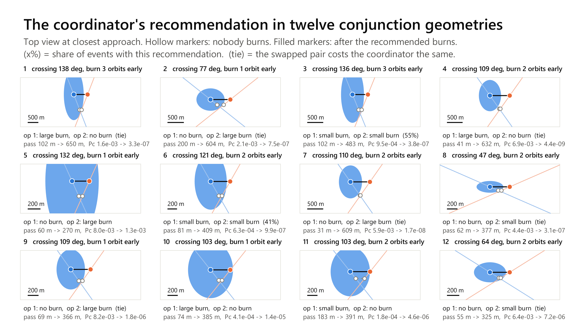

# MATLAB layer

This folder adds a MATLAB layer to the Python package `conjce` in the repository root. It

1. ports the core model (collision probability, burn-to-miss rule, cost tables, the coordinator's linear program) and checks the port against the Python numbers;
2. checks the linear burn-to-miss rule against a two-body propagation of both satellites;
3. builds a Simulink model of one conjunction event from a script;
4. renders four animations.

It changes no result of the Python package. The subject is civil space traffic coordination. The results are in `RESULTS.md`, section 4.11, and the derivations in `DERIVATIONS.md`, sections 1.8 and 2.7.



## Requirements

- MATLAB with the Optimization Toolbox (`linprog`).
- Simulink, for the model in `simulink/` and its test only.

Everything here was run with MATLAB R2024b (24.2) and Simulink 24.2 on Windows. No other release or platform was tried.

## Where the numbers come from

`export_matlab.py` in the repository root writes two files from the Python package:

| File | Content |
|---|---|
| `params.json` | Every model parameter: constants, the baseline conjunction, the settings of the two-body check, the twelve gallery conjunctions |
| `expected.json` | Reference numbers computed in Python: collision probability per joint action, cost tables, the coordinator's rules, the mixed equilibrium, a two-body reference, the learning curves |

MATLAB reads its parameters from `params.json`, so no parameter is typed twice. `expected.json` holds results of the Python package. The tests compare the MATLAB port with them. Three other places take results from it instead of recomputing them: the two-body check takes the five recommendation rules of the baseline (the public rule and four private rules), the encounter-plane and orbit animations take the recommendation they show, and the learning animation takes its learning curves. Running `export_matlab.py` again reproduced both files byte for byte.

## Layout

| Path | What it is |
|---|---|
| `core/` | Port of the core model: `pc2d.m` (collision probability), `miss_shift.m` (linear burn-to-miss rule), `cost_matrices.m` (cost tables of the game), `solve_ce.m` (the coordinator's linear program, with `linprog`), `obedience_system.m`, `mixed_nash.m`, and the loaders of the two JSON files |
| `twobody/` | Two-body check: states at the encounter, two propagators (`ode113` and a universal-variable Kepler solver), closest approach, the second-order formula of DERIVATIONS.md 2.7, the Monte Carlo estimate of DERIVATIONS.md 1.8 |
| `simulink/` | `build_conjunction_sim.m` builds `conjunction_sim.slx` block by block, `run_conjunction_sim.m` runs one event, `run_simulink_check.m` compares the model with the MATLAB propagation |
| `viz/` | One style file (`viz_style.m`), helpers, and one `make_*_animation.m` per animation |
| `tests/` | The checks; each prints one PASS or FAIL line |
| `results/` | Numbers written by the runs, as JSON |
| `figures/` | The animations (MP4, GIF, final-frame PNG) and the block diagram of the Simulink model |
| `run_tests.m`, `run_twobody_check.m`, `run_visuals.m`, `setup_paths.m` | Entry points |

## Run

From the repository root:

```
.venv\Scripts\python export_matlab.py
matlab -batch "run_twobody_check" -sd matlab
matlab -batch "setup_paths(); run_simulink_check;" -sd matlab
matlab -batch "run_visuals" -sd matlab
matlab -batch "run_tests" -sd matlab
```

| Step | What it does | Time on the machine used here |
|---|---|---|
| `export_matlab.py` | Writes `params.json` and `expected.json` from the Python package | 2 s |
| `run_twobody_check` | Propagates the nine joint actions, recomputes probabilities and incentives, runs the Monte Carlo check, writes `results/twobody_check.json` and prints the table of RESULTS.md 4.11 | 34 s |
| `run_simulink_check` | Rebuilds `simulink/conjunction_sim.slx`, runs it for the nine joint actions, writes `results/simulink_check.json` and `figures/conjunction_sim_model.png` | 45 s |
| `run_visuals` | Renders the four animations and writes `results/viz_*.json` | 78 s |
| `run_tests` | Runs every check and ends with `SUMMARY: <n> passed, <m> failed`; in batch mode the exit code is 1 if a check failed | 110 s |

`run_tests('test_core.m')` runs one test file. The two-body and Simulink tests recompute what they check. The animation tests read `results/viz_*.json` and the files in `figures/`, so render first after changing an animation.

On the machine used here, running the five steps again in a fresh clone reproduced every JSON file in this folder and the four GIFs byte for byte. Git still lists ten binary files as modified after such a run:

- `run_visuals` writes the four MP4 files and the four final-frame PNG files with a new time stamp inside each file. Their frames and pixels did not change.
- `run_simulink_check` and the Simulink test rebuild `simulink/conjunction_sim.slx` and redraw `figures/conjunction_sim_model.png`. The model is the same and gives the same numbers, but the stored file differs in its bytes, and the picture can come out slightly different, since the build script lets Simulink arrange the blocks and route the lines.

## Animations

| Animation | Files in `figures/` | What it shows |
|---|---|---|
| Encounter plane | `encounter_plane.mp4`, `.gif`, `.png` | The pass point of satellite 2 and its uncertainty ellipse in the encounter plane; each burn moves it away from satellite 1 and the collision probability falls |
| Orbits in 3D | `orbits_3d.mp4`, `.gif`, `.png` | Both orbits through the closest approach, without burns and with the coordinator's most frequent recommendation (a small burn by both), and the distance between the satellites |
| Gallery | `gallery.mp4`, `.gif`, `.png` | Twelve conjunction geometries side by side, each with the coordinator's recommendation and its outcome |
| Learning | `learning.mp4`, `.gif`, `.png` | Realised coordinator cost against the number of past events operators have seen, for four kinds of rule (RESULTS.md 4.2) |

Each MP4 is 1280 x 720; each GIF is under 8 MB; each PNG is the final frame. All four use the style file `viz/viz_style.m`, which holds the colours and type sizes of the Python figures (`conjce/figures.py`).

Two remarks on reading them:

- In the gallery, seven of the twelve cases are marked "(tie)". There the recommendation is a fixed assignment in which one operator burns, and the mirror-image rule, in which the other operator burns, is also an equilibrium and costs the coordinator exactly the same.
- The learning animation notes that the targeted private rule beats the public rule "from k = 15". That is the crossover on the grid of the stored simulation (RESULTS.md 4.2 (a)); the exact enumeration of RESULTS.md 4.2 (b) puts it at 13 past events.

## What is verified

`run_tests` runs 98 checks and all pass:

| Test file | Checks | What it compares |
|---|---|---|
| `test_core.m` | 30 | The port against the Python numbers in `expected.json`: derived orbit quantities, tables of pass distance, collision probability and cost, obedience constraints, the coordinator's rule and cost under four private schemes, the mixed equilibrium, the twelve gallery conjunctions; `pc2d` against MATLAB's `integral2` |
| `test_twobody.m` | 24 | The two propagators against each other and against the same construction in Python; the propagated miss against the second-order formula; the relative error of the linear rule; the Monte Carlo estimates; best replies, equilibria and obedience constraints under the propagated probabilities |
| `test_simulink.m` | 7 | The script builds the model; the model issues the joint action it is given and otherwise draws from the rule by inverse CDF; its miss vector against the MATLAB propagation; the rotation of the encounter axes between the nominal time and the closest approach |
| `test_viz_encounter.m`, `test_viz_gallery.m`, `test_viz_learning.m`, `test_viz_orbits.m` | 8, 10, 9, 10 | Each animation exists as MP4, GIF and PNG with the sizes above; its main numbers (pass distances, collision probabilities, recommendations, learning curves) equal their source |

Agreement observed, next to what the test allows:

| Comparison | Observed | Allowed |
|---|---|---|
| MATLAB port against Python | relative differences below 2e-14 | 1e-6 (relative, or absolute for the entries of a rule); a relative 1e-3 for collision probabilities |
| Linear burn-to-miss rule against two-body propagation | 1.1 to 19.0 mm on shifts of 243 to 1,461 m; at most 2.1e-5 of the shift | 1e-4 of the shift |
| Second-order formula (DERIVATIONS.md 2.7) against propagation | 1.2e-5 m | 2e-4 m |
| `ode113` against the Kepler solver, positions after two orbits | 1.4e-5 m | 1e-3 m |
| MATLAB propagation against the same construction in Python | 1.3e-5 m | 1e-3 m |
| Monte Carlo against the Foster integral, nine joint actions | within 2.1 standard errors | 4 standard errors |
| Simulink model against the MATLAB propagation, nine joint actions | 9.1e-6 m | 1e-3 m |

With the propagated collision probabilities no best reply and no pure equilibrium of the game changes. The largest change of a collision probability is 3.8e-9, about 44,000 times smaller than the smallest gap between an operator's best and second-best reply. The public rule and the rules with a margin keep every obedience constraint. The rule without a margin holds an operator exactly indifferent, and that tie tips by 2.2e-9 in the units of the constraint, about 45 cents on a $200M satellite. Details are in RESULTS.md 4.11.

## What is not verified

- Anything beyond two-body motion: no drag, no oblateness of the Earth, no third bodies. The check shows that the linearisation is accurate inside the two-body model. It says nothing about that model against real orbits.
- The Simulink model integrates the same equations as the MATLAB propagation. Their agreement checks the integration and the wiring of the blocks, not the physics.
- The Monte Carlo check weights its samples with the model's own Gaussian. It does not test the Gaussian shape or the size of the covariance, and with a standard error of about 4% it cannot see the difference between the linear and the propagated miss.
- How the animations look. The tests check that the files exist and that the main numbers are right, not layout or legibility.
- The learning curves. The learning animation redraws stored Python results; MATLAB does not recompute them.
- Most of the Python package. The port covers the baseline conjunction with its public rule and four private rules and the twelve gallery conjunctions. The learning simulation, the exact enumeration, the margin families, the sampled guarantees and the many-conjunction batch exist only in Python.
- Other MATLAB releases, other platforms, other solvers. Where the coordinator's program has a tie, another version of `linprog` may return the other optimal rule.

## Two comparisons that failed at first

Both are also listed in RESULTS.md, section 7 (items 12 and 13). In neither case was a tolerance or a reference number changed.

1. **Gallery recommendations.** The first test required MATLAB and Python to recommend the same joint action in all twelve gallery cases. It failed in cases 2 and 4. The coordinator's cost does not depend on which operator burns. So when the best rule is a fixed assignment in which only one operator burns, and its mirror image is also an equilibrium, the linear program has two optimal rules of equal cost, and `linprog` and the Python solver may return different ones. Seven of the twelve cases have such a tie; in five of them the two solvers return the same rule. The test now requires the same recommendation or an exact tie, and a second check confirms the seven ties from the Python numbers alone.
2. **Simulink miss vector.** The first comparison with the MATLAB propagation was off by 8.7 cm in the radial component for one large burn. The model's miss vector was right. Its output axes had been built from the velocities at the nominal time instead of at the closest approach, and between those instants the axes turn by `(d1 + d2) / (2 a cos(phi/2))`, here 1.05e-4 rad (DERIVATIONS.md 2.7). The output is now projected on the nominal axes, and a check of its own tests that rotation.
